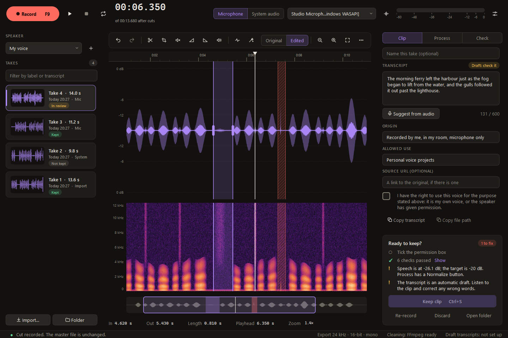
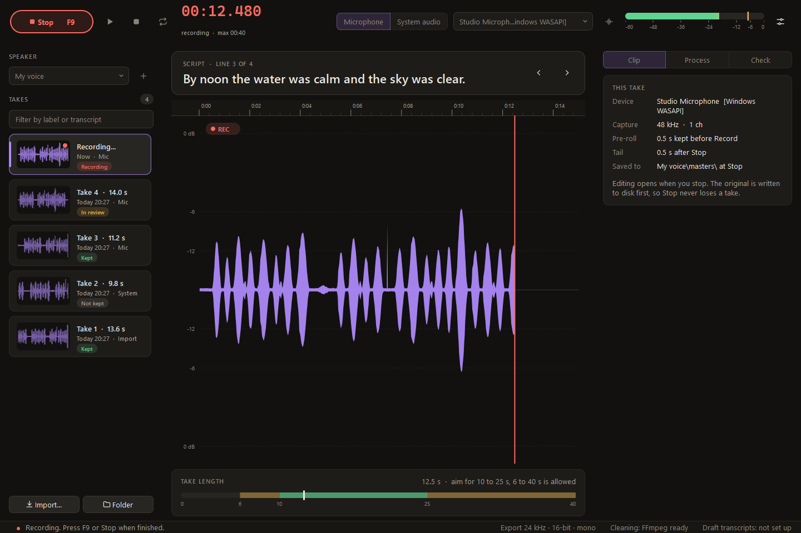
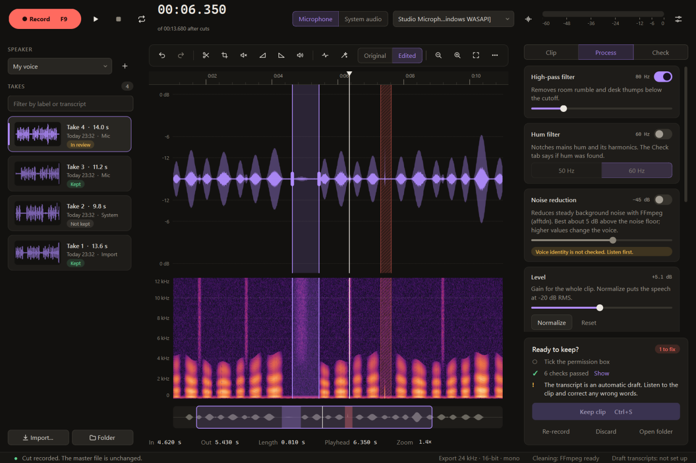
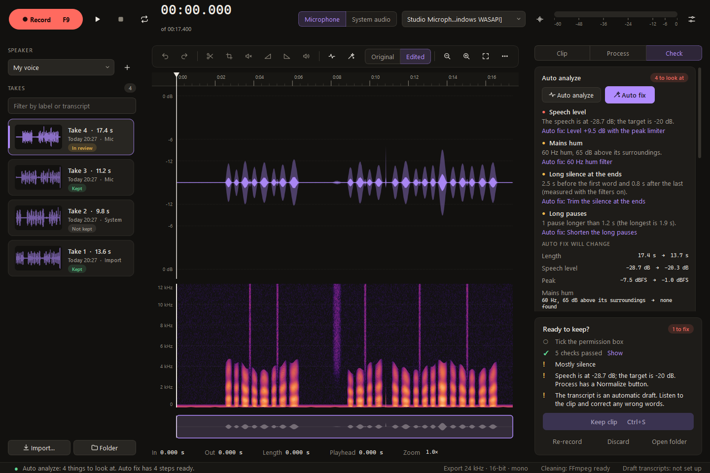
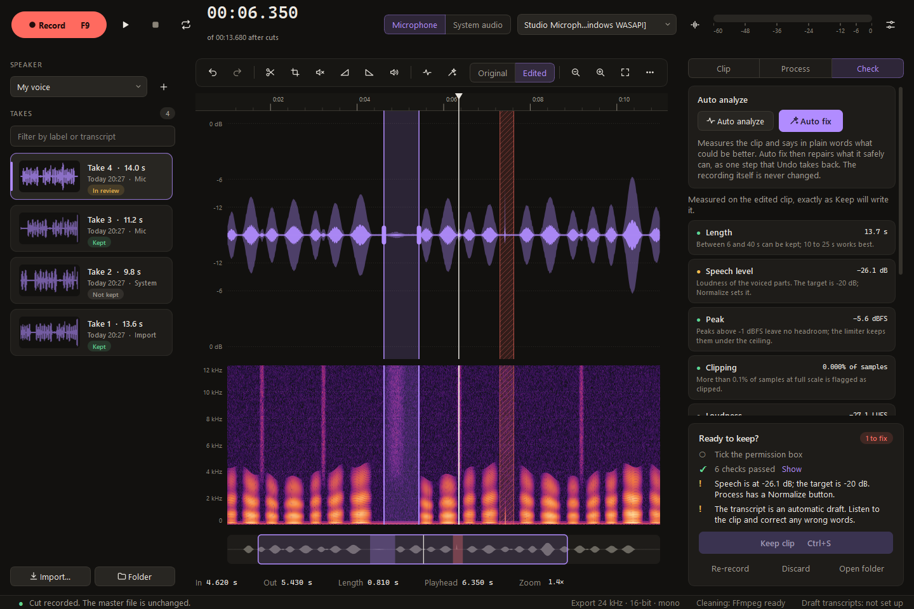

# Fel's Voice Slate - Voice and Clip Recorder

Record, tidy and document clean voice clips on Windows. Each clip is saved with its transcript, where it came from, and
what it may be used for, written next to the audio.



*The screenshots in this project show generated test audio, not a real person's voice.*

Fel's Voice Slate is for anyone who needs a few good recordings of one voice: reference clips for text-to-speech tools,
samples for a speech dataset, voice banking, or audition takes. It records from a microphone, lets you cut and clean the
take, checks the result against sensible quality rules, and saves a 24 kHz WAV together with a JSON file that says what
is in it and whether you had the right to record it.

> **Record only voices you own or have permission to use.** The app will not keep a clip until you confirm that, and
> [Responsible use](docs/responsible-use.md) explains what it means and why it asks.

## What it does

- **Record** from a microphone, or from what your computer is playing. An armed input keeps the half second before you
  press Record, so the first word is never cut off. Script mode shows one prompt per take.
- **Never loses a take.** The original recording is written to disk the moment you stop. Edits are a list of steps kept
  beside it, so they can always be undone and the original is never changed.
- **Edit** by dragging on the waveform: cut, trim, silence, fade in and out, gain on a part, trim the pauses at the
  ends, shorten long pauses, and compare the original with the edited clip. Undo and redo have a clickable history.
- **Process** the whole take: high-pass filter, mains-hum notch (50 or 60 Hz), noise reduction (optional, needs
  FFmpeg), a Normalize button that sets the speech to -20 dB, and a peak limiter.
- **Check** the clip as it will be saved: length, speech level, peak, clipping, loudness, noise floor, bandwidth, hum and
  silence, each with a verdict and a short explanation.
- **Auto analyze and Auto fix**: one button looks at the take and says in plain words what could be better (long
  silences, hum, rumble, noise, a quiet voice, clipping); the other repairs what can be repaired safely, in one step
  that Undo takes back. Noise reduction, which can change the voice, is only used on a clearly noisy clip, and only if
  it helps.
- **Keep** only when the clip is ready: it needs a transcript, the origin of the recording, the allowed use, and your
  confirmation that you have the right to use the voice. Keep writes the 24 kHz mono WAV and a sidecar JSON file.
- **Draft transcripts** (optional) from a speech recognizer that runs on your own computer.
- **Stays on your computer.** No account, no network access, no telemetry. Discard sends files to the Recycle Bin.

| | |
|---|---|
|  |  |
| Recording, with a script prompt and a take-length guide | Process: filters, noise reduction, level and limiter |
|  |  |
| Auto analyze: what could be better, and what Auto fix would change | Check: every measurement, with a verdict |

## Install

You need 64-bit **Windows** and **Python 3.12 or newer** ([python.org](https://www.python.org/downloads/)). It is
developed and tested on Windows 11; Windows 10 has not been tested. A microphone is needed to record; importing audio
files works without one.

1. Download this repository (the green **Code** button, then **Download ZIP**, and unzip it) or clone it with Git.
2. Double-click **`setup.bat`** once. It creates a private Python environment in the `.venv` folder, installs the
   packages in [requirements.txt](requirements.txt) from PyPI (it needs an internet connection), checks the install,
   puts a **Fel's Voice Slate icon in the program folder**, and offers to put one on your desktop too.
3. Start Voice Slate from that icon. It opens with no console window, and only one copy runs at a time: a second
   click brings the first window forward. **`run.bat`** starts it too, in a console window that shows any error message.
   The icon is a shortcut file, which holds the paths of the computer it was made on, so it cannot be passed on: every
   copy of the program makes its own with `setup.bat`, and if you move the folder, run `setup.bat` again.

Prefer a terminal? In the project folder:

```bash
python -m venv .venv
.venv\Scripts\python -m pip install -r requirements.txt
.venv\Scripts\python -m recorder --check
.venv\Scripts\python -m recorder --shortcut folder
.venv\Scripts\python -m recorder
```

`--check` says what is installed and what is missing, and `--shortcut folder` makes the icon in the program folder
(`--shortcut` alone makes one on the desktop, `--shortcut start-menu` one in the Start menu). Nothing is installed
outside the project folder, apart from the settings file, the log file and your recordings (see below).

## Your first clip

1. Choose **Microphone** and your device at the top. Click the **Arm** button (the small waveform icon, or `Ctrl+M`)
   and speak: the level meter should move.
2. Press **Record** (`F9`), read a sentence or two aloud (10 to 25 seconds is ideal), and press `F9` again. `F9` works
   while another program is in front too, and the taskbar button flashes to show it was heard (**Settings** can turn
   this off). The original is saved straight away and the editor opens.
3. Select a part by dragging on the waveform and press `Delete` to cut it, or use the buttons above the waveform. Press
   `Space` to listen, and `A` to switch between the original and the edited clip.
4. On the **Process** tab, switch on what you need, and press **Normalize**. The **Check** tab shows how the clip
   measures.
5. On the **Clip** tab, check the transcript, say where the recording came from and what it may be used for, and tick
   the permission box.
6. Press **Keep clip** (`Ctrl+S`).

The [user guide](docs/user-guide.md) covers every control, script mode, importing, speakers, and what to do when
something does not work.

## Where your files go

By default in a `voice-clips` folder inside the program folder, so the recordings stay beside the program that made
them. Git ignores that folder, and it holds a `.gitignore` of its own that ignores everything in it. If the program
folder is in OneDrive, Dropbox or another synced folder, or cannot be written to, `C:\Users\<you>\Recordings\voice-clips`
is used instead. Change it in **Settings** (the gear at the top right).

```text
voice-clips\
  speakers.json
  my-voice\                                   one folder per speaker
    masters\
      20261020-161204_mic_3f9a1c2e.raw.wav    the original recording, 24-bit, never changed
    20261020-161204_mic_3f9a1c2e.wav          the kept clip: 24 kHz, mono, 16-bit
    20261020-161204_mic_3f9a1c2e.json         the sidecar: transcript, origin, allowed use, edits, measurements
```

The sidecar holds everything needed to see how the clip was made, including the edit list and the processing settings.
Its fields are described in [Clip format](docs/clip-format.md), so other programs can read it.

Recordings of a voice are personal data. Keep the folder out of OneDrive, Dropbox and other synced folders unless you
want a copy in the cloud, leave `voice-clips` out when you zip or share the program folder, and see
[Responsible use](docs/responsible-use.md).

## Optional extras

Both are off until you set them up, and the recorder works fully without them.

**Noise reduction** uses [FFmpeg](https://ffmpeg.org). Install it yourself, for example `winget install Gyan.FFmpeg`,
and restart Voice Slate. It is found automatically, or you can give its path in **Settings**. The recorder runs FFmpeg
as a separate program and does not include it.

**Draft transcripts** use [faster-whisper](https://github.com/SYSTRAN/faster-whisper) running on your computer. You
need a Python environment with faster-whisper installed, and a faster-whisper model folder that you downloaded
yourself. Put the path of that environment's `python.exe` and the model folder in **Settings**, and the language you
speak if you know it (for example `en`), which makes the draft faster and steadier. The status bar at the bottom says
"Draft transcripts: ready" once both are found. Voice Slate never downloads a
model, and the worker refuses anything but a local folder. Stretches of silence are skipped, so a pause is not turned
into invented words. The result is only a draft: listen to the clip and correct it, because the app does not know
whether it is right.

## Privacy and responsible use

- Voice Slate makes no network connections and sends nothing anywhere. The only downloads are the ones you do
  yourself: the Python packages at setup, and FFmpeg or a speech model if you choose to add them.
- `F9` works in other programs through one Windows hotkey: Windows tells Voice Slate when that one key is pressed, and
  Voice Slate sees no other key. It is not a keyboard hook, and **Settings** turns it off.
- It asks for the origin, the allowed use and your confirmation for every clip, and saves them with the audio.
- **Record only your own voice, or voices of people who have clearly agreed.** Do not use it to impersonate someone, to
  deceive, or to record people without their knowledge. System-audio capture is for audio you own or may use.
- The tick box is a reminder and a record of what you said. It is not a legal release. Get written permission when the
  voice is someone else's.

Read [docs/responsible-use.md](docs/responsible-use.md) before you record anyone else.

## Limits

- Windows only. Capturing system audio uses WASAPI loopback, and Discard uses the Windows Recycle Bin.
- One voice per clip, saved as mono. Clips must be 6 to 40 seconds and have a transcript of 3 to 600 characters; these
  limits are constants at the top of [recorder/audio_core.py](recorder/audio_core.py).
- It is a voice-clip recorder, not a general audio editor: there is one track, and no effects beyond those listed above.

## Documentation

| | |
|---|---|
| [User guide](docs/user-guide.md) | Every control, with tips and troubleshooting |
| [Responsible use](docs/responsible-use.md) | Consent, privacy, and what this tool is not for |
| [Clip format](docs/clip-format.md) | The folder layout and the sidecar JSON, for other programs |
| [Architecture](docs/architecture.md) | How the code is organised, for contributors |
| [Contributing](CONTRIBUTING.md) | Setting up, running the tests, and sending changes |
| [Security](SECURITY.md) | Reporting a vulnerability |
| [Changelog](CHANGELOG.md) | What changed in each version |
| [Third-party notices](THIRD_PARTY_NOTICES.md) | The libraries it uses and their licences |

## Development

```bash
python -m venv .venv
.venv\Scripts\python -m pip install -r requirements-dev.txt
.venv\Scripts\python -m pytest
.venv\Scripts\python -m pyflakes recorder tests tools
```

The tests need no microphone, speakers or display: the window tests run on Qt's offscreen platform with a fake
recorder and fake dialogs. `python tools/shoot.py` redraws the screenshots in `docs/images` from generated audio, and
`python tools/make_icon.py` redraws the program's icon. [CONTRIBUTING.md](CONTRIBUTING.md) has the rest.

## Licence

Released under the [MIT License](LICENSE). It uses Qt for Python under the LGPL-3.0 and other open-source libraries; see
[THIRD_PARTY_NOTICES.md](THIRD_PARTY_NOTICES.md).
