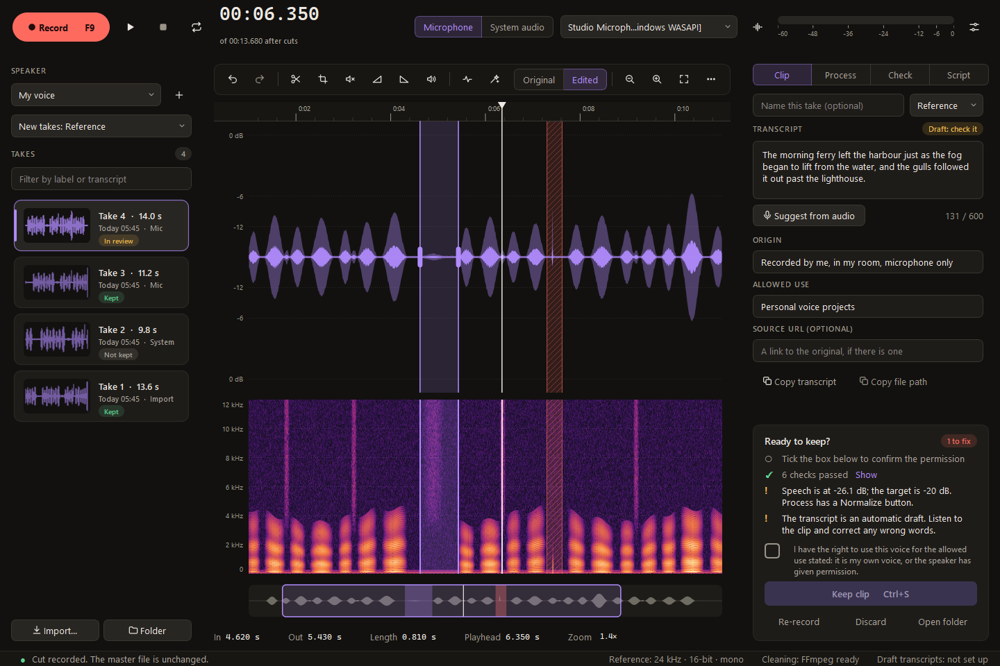
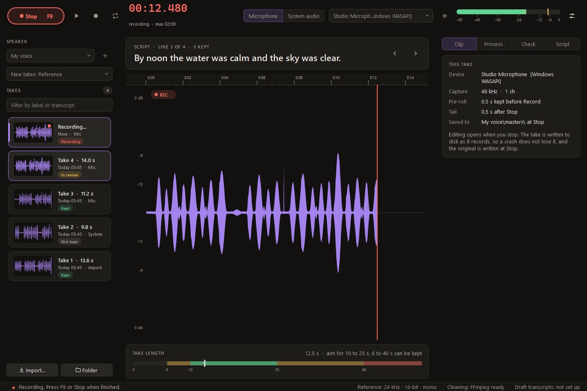
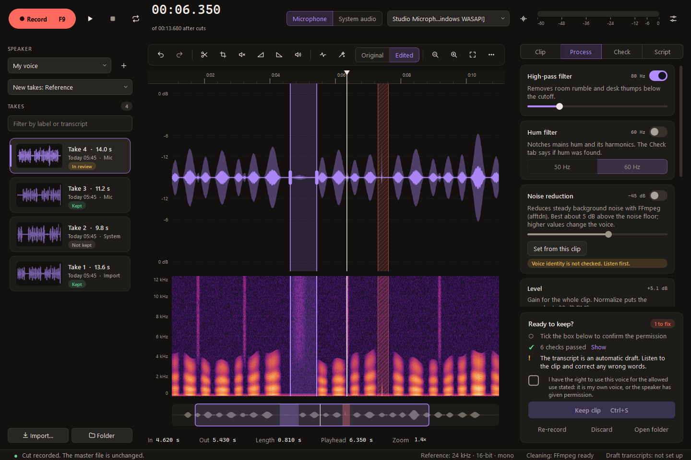
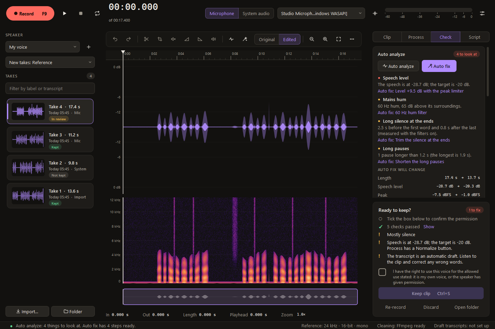
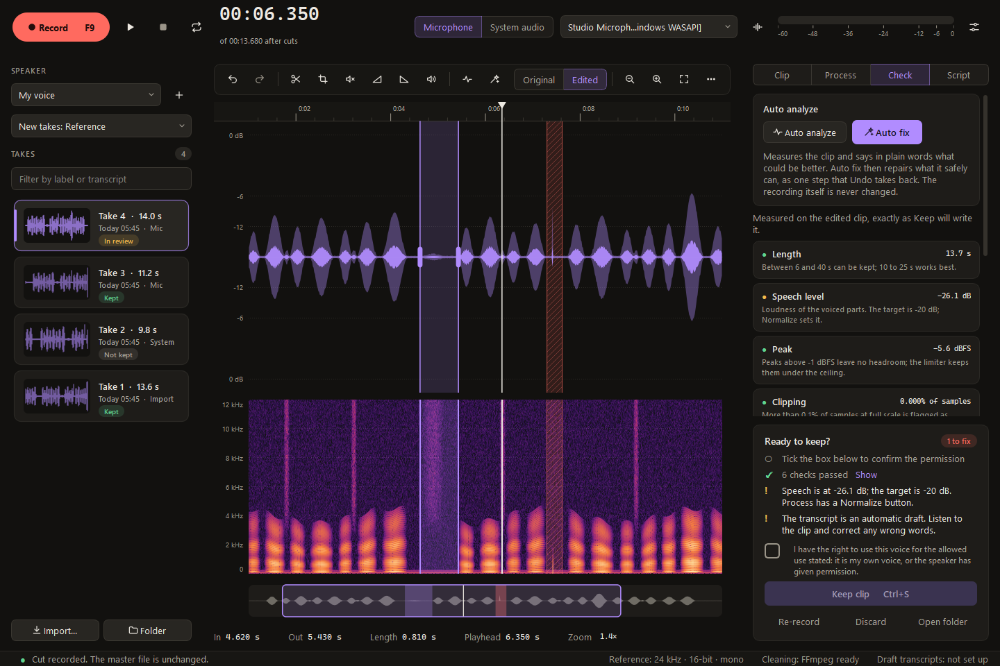
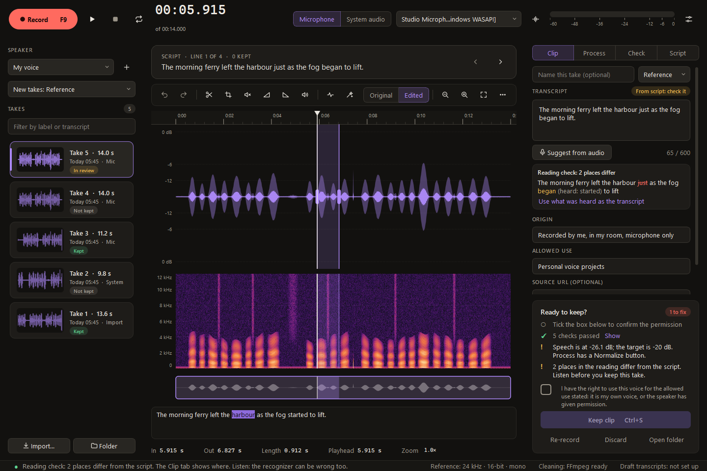
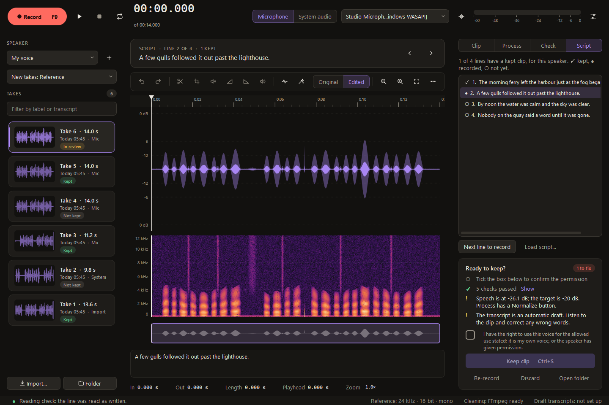
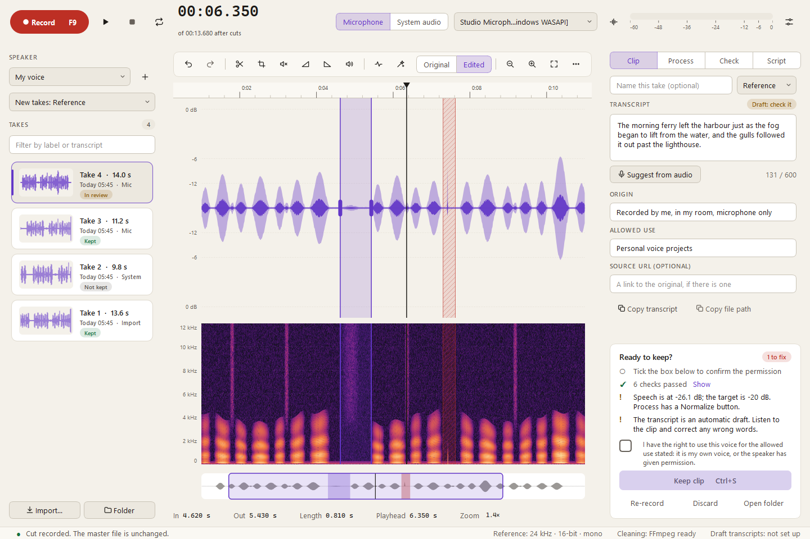
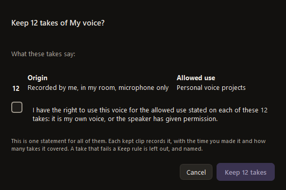

# Fel's Voice Slate - Voice and Clip Recorder

Record, tidy and document clean voice clips on Windows. Each clip is saved with its transcript, where it came from, and
what it may be used for, written next to the audio.



*The screenshots in this project show generated test audio, not a real person's voice.*

Fel's Voice Slate is for anyone who needs good recordings of one voice: reference clips for text-to-speech tools, a
sentence at a time for a speech dataset or voice banking, or full audition takes. It records from a microphone, lets you cut
and clean the take, checks the result against sensible quality rules, and saves a WAV together with a JSON file that says
what is in it and whether you had the right to record it.

> **Record only voices you own or have permission to use.** The app will not keep a clip until you confirm that, and
> [Responsible use](docs/responsible-use.md) explains what it means and why it asks.

## What it does

- **Three purposes.** A *Reference* is 6 to 40 seconds at 24 kHz, a *Sentence* is 1 to 15 seconds for a dataset or voice
  banking, and an *Audition* runs up to 10 minutes and is kept at up to 48 kHz and 24-bit. Each has its own rules.
- **Record** from a microphone, or from what your computer is playing. An armed input keeps the half second before you
  press Record, so the first word is never cut off, and it stays armed from one take to the next. On an interface with
  several inputs you choose which one.
- **Long sessions.** A script shows one prompt per take, remembers your place, and shows which lines have a kept clip. Keys
  walk the takes, and several takes can be kept, discarded or moved together.
- **Reading check** (needs draft transcripts). A take read from a script is compared with what the recognizer heard, and the
  places that differ are shown.
- **Never loses a take.** A take is written to disk while you record it, and the original recording is written the moment
  you stop. Your edits, settings and typed text are saved beside it a moment after each change, on a kept clip as well, so
  a close loses nothing and a crash costs only the last moment. Edits are a list of steps, so the original is never
  changed.
- **Edit** by dragging on the waveform: cut, trim, silence, fade in and out, gain on a part, trim the pauses at the
  ends, shorten long pauses, and compare the original with the edited clip. Undo and redo have a clickable history. With a
  draft transcript you can also cut by clicking the words, and a long take can be split at its pauses.
- **Process** the whole take: high-pass filter, mains-hum notch (50 or 60 Hz), noise reduction (optional, needs
  FFmpeg), a Normalize button that sets the speech to -20 dB, and a peak limiter.
- **Check** the clip as it will be saved: length, speech level, peak, clipping, loudness, noise floor, bandwidth, hum and
  silence, each with a verdict and a short explanation.
- **Auto analyze and Auto fix**: one button looks at the take and says in plain words what could be better (long
  silences, hum, rumble, noise, a quiet voice, clipping); the other repairs what can be repaired safely, in one step
  that Undo takes back. Noise reduction, which can change the voice, is only used on a clearly noisy clip, set from the
  noise that clip has, and only if it lowers the noise and leaves the voice.
- **Keep** only when the clip is ready: it needs a transcript, the origin of the recording, the allowed use, and your
  confirmation that you have the right to use the voice. Keep writes the mono WAV and a sidecar JSON file. A speaker's signed
  release can be kept with their clips, with the date it runs out.
- **Name and find takes.** Give a take a label, rename a speaker, and filter the list of takes by the words in their
  labels, transcripts and notes. A take recorded under the wrong speaker can be moved to the right one.
- **Share.** Drag a kept clip into Explorer or another program, save a copy as WAV, FLAC, MP3 or Ogg at 16 to 48 kHz, export
  a manifest of the kept clips (JSON Lines or CSV), or a whole dataset in one folder, as clips with sidecars or in the LJSpeech
  layout. The kept clips are never changed.
- **Draft transcripts** (optional) from a speech recognizer that runs on your own computer, set up in one step.
- **For everyone.** Dark, light and high-contrast themes, a size setting for the whole window, screen-reader names and
  keyboard access throughout, and the window in English, German, Spanish or French.
- **Stays on your computer.** No account, no network access, no telemetry. Discard sends files to the Recycle Bin.

| | |
|---|---|
|  |  |
| Recording, with a script prompt and a take-length guide | Process: filters, noise reduction, level and limiter |
|  |  |
| Auto analyze: what could be better, and what Auto fix would change | Check: every measurement, with a verdict |
|  |  |
| The reading check, and the words of the take to cut by | The Script tab: how far a long script has got |
|  |  |
| The light theme | Keeping several takes takes a statement, every time |

## Install

You need 64-bit **Windows**. It is developed and tested on Windows 11; Windows 10 has not been tested. A microphone is needed
to record; importing audio files works without one.

**The installer needs nothing else.** Download `Fels-Voice-Slate-<version>-Setup.exe` from the
[latest release](https://github.com/Fel101/fels-voice-slate/releases/latest) and run it. It brings its own private copy of
Python, installs for you alone, asks for no administrator rights, and puts Voice Slate in the Start menu. The installer has no
paid signature yet, so Windows SmartScreen may say *Windows protected your PC*: choose **More info**, then **Run anyway**. The
first start can take up to about 20 seconds while Windows looks over the new files; after that it opens in a few seconds. To
remove it, use Windows' *Installed apps*. Your recordings and settings stay where they are.

**To run it from the source** you need **Python 3.12 or newer** ([python.org](https://www.python.org/downloads/)). Draft
transcripts need Python 3.12 to 3.14, because their packages are not built for newer versions yet. If you have Python 3.15,
install 3.14 beside it (`py install 3.14`) and the setup finds it by itself.

1. Download this repository (the green **Code** button, then **Download ZIP**, and unzip it) or clone it with Git.
2. Double-click **`setup.bat`** once. It creates a private Python environment in the `.venv` folder, installs the
   packages in [requirements.txt](requirements.txt) from PyPI (it needs an internet connection), checks the install,
   puts a **Fel's Voice Slate icon in the program folder**, and offers to put one on your desktop too. At the end it
   asks whether to set up **draft transcripts** as well (see below); answer `n` and do it later if you are not sure.
3. Start Voice Slate from that icon. It opens with no console window, and only one copy runs at a time: a second
   click brings the first window forward. **`run.bat`** starts it too, in a console window that shows any error message.
   The icon is a shortcut file, which holds the paths of the computer it was made on, so it cannot be passed on: every
   copy of the program makes its own with `setup.bat`, and if you move the folder, run `setup.bat` again.

Prefer a terminal? In the project folder:

```bash
python -m venv .venv
.venv\Scripts\python -m pip install -r requirements.txt
.venv\Scripts\python -m recorder --check
.venv\Scripts\python -m recorder --shortcut folder
.venv\Scripts\python -m recorder
```

`--check` says what is installed and what is missing, and `--shortcut folder` makes the icon in the program folder
(`--shortcut` alone makes one on the desktop, `--shortcut start-menu` one in the Start menu). Nothing is installed
outside the project folder, apart from the settings file, the log file and your recordings (see below).

Your recordings are safe when you update: they are in your own folder, not in the program's. A copy from before 0.5 that has a
`voice-clips` folder goes on using it until you move it (see [Updating](#updating)).

## Updating

- **If you used the installer**, run the new one. It asks you to close Voice Slate if it is open, and your recordings, settings
  and speech model stay as they are.
- **If you cloned it with Git**, close Voice Slate, run `git pull` in the program folder, and run `setup.bat` again.
- **If you downloaded a ZIP**, close Voice Slate, unzip the new version somewhere new, copy `settings.json` across if you have
  one, and run `setup.bat` there.

**Coming from a version before 0.5?** Those kept recordings in a `voice-clips` folder inside the program folder, so **do not
delete the old program folder until you have moved that folder out of it.** The simplest way: in the old copy updated in place,
open **Settings**, choose a new **Output folder** such as `C:\Users\<you>\Recordings\voice-clips`, and answer **Move them**.
Each file is copied and checked, and the old ones are removed once all of them have arrived. With a ZIP, move `voice-clips`
into the new folder first and do the same there.

## Your first clip

1. Choose **Microphone** and your device at the top. Click the **Arm** button (the small waveform icon, or `Ctrl+M`)
   and speak: the level meter should move.
2. Press **Record** (`F9`), read a sentence or two aloud (10 to 25 seconds is ideal for a Reference), and press `F9` again.
   The original is saved straight away and the editor opens. **Settings** can change the key, and can let it work while
   another program is in front.
3. Select a part by dragging on the waveform and press `Delete` to cut it, or use the buttons above the waveform. Press
   `Space` to listen, and `A` to switch between the original and the edited clip.
4. On the **Process** tab, switch on what you need, and press **Normalize**. The **Check** tab shows how the clip
   measures.
5. On the **Clip** tab, check the transcript, and say where the recording came from and what it may be used for.
6. Tick the permission box under **Ready to keep?** and press **Keep clip** (`Ctrl+S`).

The [user guide](docs/user-guide.md) covers every control, script mode, importing, speakers, and what to do when
something does not work.

## Where your files go

By default in `C:\Users\<you>\Recordings\voice-clips`, in your own folder and not in Documents, which OneDrive often syncs.
Updating or removing the program does not touch it. A copy from before 0.5 goes on using the `voice-clips` folder inside its
program folder, if it has recordings in it. Change it in **Settings** (the gear at the top right), which offers to move what is
there.

```text
voice-clips\
  speakers.json
  my-voice\                                      one folder per speaker
    masters\
      20261020-161204_mic_3f9a1c2e.raw.wav       the original recording, 24-bit, never changed
      20261020-161204_mic_3f9a1c2e.autosave.json your edits and text, until Keep writes them
    20261020-161204_mic_3f9a1c2e.wav             the kept clip: mono, 24 kHz and 16-bit (48 kHz and 24-bit for an audition)
    20261020-161204_mic_3f9a1c2e.json            the sidecar: transcript, origin, allowed use, edits, measurements
    release\                                     the signed release, if you put one on record
```

The sidecar holds everything needed to see how the clip was made, including the edit list and the processing settings.
Its fields are described in [Clip format](docs/clip-format.md), so other programs can read it. The autosave file is there
only until Keep writes your work: Keep deletes it, and it is not part of the format that other programs read.

Recordings of a voice are personal data. Keep the folder out of OneDrive, Dropbox and other synced folders unless you
want a copy in the cloud, and see [Responsible use](docs/responsible-use.md).

## Optional extras

Both are off until you set them up, and the recorder works fully without them.

**Noise reduction** uses [FFmpeg](https://ffmpeg.org). Install it yourself, for example `winget install Gyan.FFmpeg`,
and restart Voice Slate. It is found automatically, or you can give its path in **Settings**. The recorder runs FFmpeg
as a separate program and does not include it.

**Draft transcripts** use [faster-whisper](https://github.com/SYSTRAN/faster-whisper) running on your computer. They also make
the reading check and cutting by clicking words possible. Press **Suggest from audio** and choose *Open the setup* (or
double-click **`setup-transcripts.bat`** in the program folder, or answer `y` when `setup.bat` asks). It asks which speech model
you want and which language you speak, tells you what it will download, and waits for your yes:

| Model | Download | |
|---|---|---|
| `tiny` | about 80 MB | the fastest, and the roughest drafts |
| `base` | about 150 MB | a good middle (the default) |
| `small` | about 490 MB | the most accurate, and the slowest |

The model is downloaded from SYSTRAN's repositories on [Hugging Face](https://huggingface.co/Systran) into a `models`
folder. On top of it the setup installs the recognizer itself, about 90 MB from PyPI, into a `.venv-asr` folder. Both
folders stay beside the program, and Git ignores them. The only other traces are the usual download caches in your user
folder: pip's, and a few small files in Hugging Face's. When the recognizer has run once on a second of silence, the
setup fills in the matching lines in **Settings** for you. Start Voice Slate again, and the status bar at the bottom
says "Draft transcripts: ready".

The recognizer needs Python 3.12 to 3.14, which the installed program has and which can sit beside a newer Python that runs a
source copy, and Microsoft's Visual C++ runtime, which most computers already have. If either is missing, the setup says what
to install before it downloads anything.

Voice Slate itself never goes online: the setup is the only thing that downloads, only when you run it and agree, and
it sends nothing about you or your recordings. The worker that makes the drafts refuses anything but a local model
folder. Stretches of silence are skipped, so a pause is not turned into invented words. The result is only a draft:
listen to the clip and correct it, because the app does not know whether it is right.

If you already have faster-whisper in a Python environment and a model folder, you do not need the setup: put the path
of that environment's `python.exe` and of the model folder in **Settings**, and the language you speak if you know it
(for example `en`), which makes the draft faster and steadier. `python -m recorder --setup-transcripts small --language
de --yes` does the whole setup without questions, for a script.

## Privacy and responsible use

- Voice Slate makes no network connections and sends nothing anywhere. The only downloads are the ones you start
  yourself: the Python packages at setup, the speech recognizer and model if you run `setup-transcripts.bat`, and FFmpeg
  if you choose to add it. Each of those shows what it fetches and where from.
- The record key can be set to work in other programs, in **Settings**. It is off until you turn it on. It is one Windows
  hotkey: Windows tells Voice Slate when that one key is pressed, and Voice Slate sees no other key. It is not a keyboard
  hook. While a recording runs with the window out of sight, a sign stays on top of everything.
- It asks for the origin, the allowed use and your confirmation for every clip, and saves them with the audio.
- **Record only your own voice, or voices of people who have clearly agreed.** Do not use it to impersonate someone, to
  deceive, or to record people without their knowledge. System-audio capture is for audio you own or may use.
- The tick box is a reminder and a record of what you said. It is not a legal release. Get written permission when the
  voice is someone else's.

Read [docs/responsible-use.md](docs/responsible-use.md) before you record anyone else.

## Limits

- Windows only. Capturing system audio uses WASAPI loopback, and Discard uses the Windows Recycle Bin.
- One voice per clip, saved as mono. The length of a clip depends on its purpose, and it needs a transcript of 3 to 600
  characters; these limits are at the top of [recorder/audio_core.py](recorder/audio_core.py).

| Purpose | A clip can be | Best | A recording stops at | Kept as |
|---|---|---|---|---|
| Reference | 6 to 40 s | 10 to 25 s | 2 minutes | 24 kHz, 16-bit |
| Sentence | 1 to 15 s | 2 to 10 s | 1 minute | 24 kHz, 16-bit |
| Audition | 3 s to 10 minutes | 30 s to 3 minutes | 15 minutes | up to 48 kHz, 24-bit, never above the recording's own rate |

- The window needs at least 1100 by 600 of the screen, so a very large size setting may not fit a small screen.
- The translations cover the window, and not yet every message or the documents.
- It is a voice-clip recorder, not a general audio editor: there is one track, and no effects beyond those listed above.

## Documentation

| | |
|---|---|
| [User guide](docs/user-guide.md) | Every control, with tips and troubleshooting |
| [Responsible use](docs/responsible-use.md) | Consent, privacy, and what this tool is not for |
| [Clip format](docs/clip-format.md) | The folder layout and the sidecar JSON, for other programs |
| [Architecture](docs/architecture.md) | How the code is organised, for contributors |
| [Contributing](CONTRIBUTING.md) | Setting up, running the tests, and sending changes |
| [Security](SECURITY.md) | Reporting a vulnerability |
| [Changelog](CHANGELOG.md) | What changed in each version |
| [Third-party notices](THIRD_PARTY_NOTICES.md) | The libraries it uses and their licences |

## Development

```bash
python -m venv .venv
.venv\Scripts\python -m pip install -r requirements-dev.txt
.venv\Scripts\python -m pytest
.venv\Scripts\python -m pyflakes recorder tests tools
```

The tests need no microphone, speakers or display: the window tests run on Qt's offscreen platform with a fake
recorder and fake dialogs. `python tools/shoot.py` redraws the screenshots in `docs/images` from generated audio,
`python tools/make_icon.py` redraws the program's icon, and `python tools/build_installer.py` builds the installer.
[CONTRIBUTING.md](CONTRIBUTING.md) has the rest.

## Licence

Released under the [MIT License](LICENSE). It uses Qt for Python under the LGPL-3.0 and other open-source libraries; see
[THIRD_PARTY_NOTICES.md](THIRD_PARTY_NOTICES.md).
