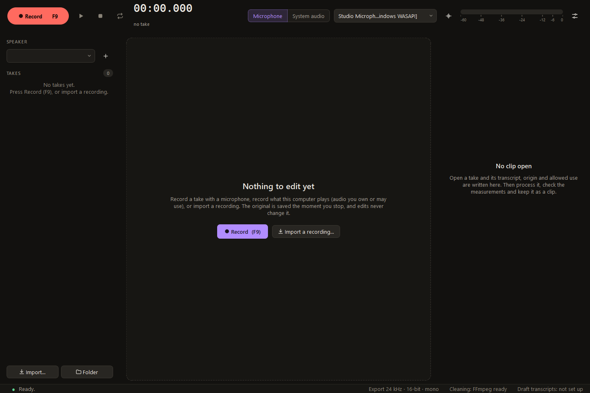
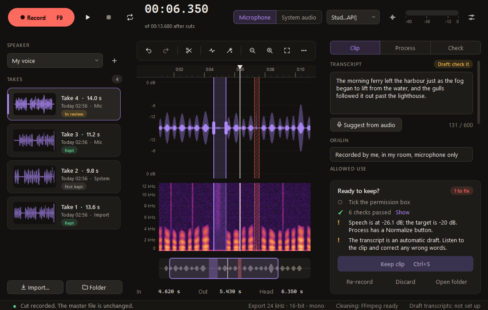
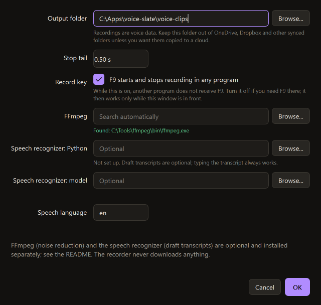
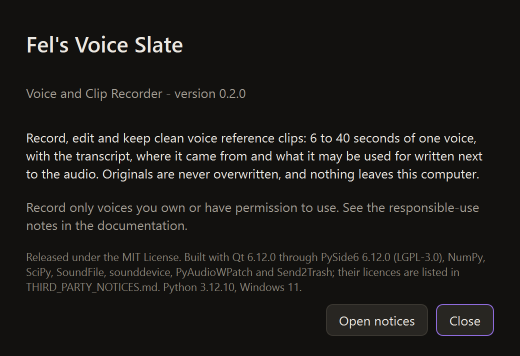
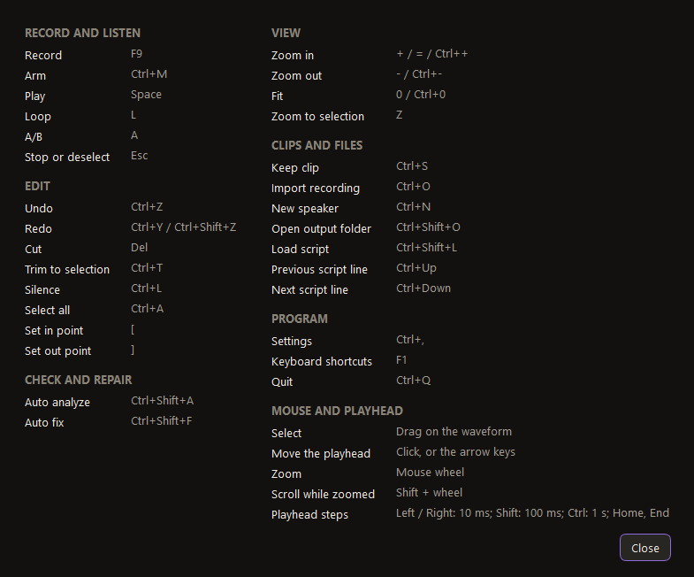

# User guide

This guide goes through Voice Slate from the first start to a kept clip. For installation, see the
[README](../README.md). Press `F1` in the program for the list of keyboard shortcuts.

**Contents:** [Starting](#starting) · [The window](#the-window) · [Recording](#recording) · [Script mode](#script-mode) ·
[Importing audio](#importing-audio) · [Speakers](#speakers) · [Editing](#editing) · [Process](#process-the-whole-take) ·
[Check](#check) · [Auto analyze and Auto fix](#auto-analyze-and-auto-fix) · [Keeping a clip](#keeping-a-clip) ·
[Settings](#settings) · [Keyboard shortcuts](#keyboard-shortcuts) · [Troubleshooting](#troubleshooting)

## Starting

Start Voice Slate from its **icon**. `setup.bat` makes one in the program folder (*Fel's Voice Slate*) and offers one on
your desktop. To make one later, run `.venv\Scripts\python -m recorder --shortcut folder` in the program folder (or
`--shortcut` for the desktop, `--shortcut start-menu` for the Start menu). The icon opens the program with no console
window, and only one copy runs at a time: click it again and the window that is already open comes forward. An icon is a
shortcut file that holds the paths of the computer it was made on, so it cannot be copied to another computer, and if
you move the program folder you make it again.

`run.bat` starts the program in a console window instead. Use it when something does not start: any error message it
prints stays on screen. Either way the program keeps a log file (see [Troubleshooting](#troubleshooting)).

To keep the program on the taskbar, pin the desktop icon (right-click it) rather than the open window.

## The window

| Area | What it holds |
|---|---|
| **Top bar** | Record (`F9`), Play (`Space`), Stop, Loop (`L`); the clock; the source (Microphone or System audio) and the device; the Arm button; the level meter; and the gear menu with Settings, Import, New speaker, Load script, Open output folder and more. |
| **Left** | The speaker, and that speaker's takes. Each take shows a small waveform, its length, when it was made, where it came from, and a status: *Recording*, *In review* (the take that is open), *Kept*, *Not kept*, or *Not saved* (the original could not be written yet). |
| **Middle** | The editor: tools, the waveform, a spectrogram, an overview strip, and a line with In, Out, Length, Playhead and Zoom. While recording it shows the live waveform and a take-length guide instead. |
| **Right** | Three tabs, **Clip**, **Process** and **Check**, and under them the **Ready to keep?** card with Keep, Re-record, Discard and Open folder. |
| **Bottom** | A status line, and the state of the optional extras (FFmpeg and draft transcripts). |

When nothing is open, the middle of the window offers **Record** and **Import a recording**:

The window can be resized down to 1100 by 700. Buttons that no longer fit collapse into a menu instead of being cut off.

## Recording

1. Choose a **source** at the top.
   - **Microphone** lists the input devices Windows reports. The same microphone can appear more than once, once for each
     Windows audio interface (WASAPI, MME, DirectSound, WDM-KS); if one entry gives no sound, try another.
   - **System audio** records what the computer is playing through the chosen output (WASAPI loopback). Use it only for
     audio you own or may use; see [Responsible use](responsible-use.md). It records only while something plays.
2. Click **Arm** (`Ctrl+M`) to open the input before you record. The level meter becomes live, and Voice Slate keeps
   the last half second, so when you press Record the beginning of the first word is already included. Arming is
   optional: Record opens the input itself if you did not.
3. Press **Record** (`F9`). The clock runs, the waveform draws live, and a bar shows where the take length falls
   against the rules: 6 seconds is the minimum, 10 to 25 seconds is the sweet spot, and recording stops by itself at
   40 seconds.
4. Press `F9` (or **Stop**) when you have finished. Recording carries on for a short **stop tail** (half a second by
   default, see [Settings](#settings)) so the end of the last word is not cut off.

`F9` also works while another program is in front, so you can start and stop a take from the page you are reading or the
program that is playing the audio you capture. When it is heard from another program, the taskbar button flashes. While
Voice Slate holds `F9` this way, other programs do not receive it: turn **Record key** off in [Settings](#settings) if
you need `F9` there, and it then works only while the Voice Slate window is in front. A dialog that is open is never
interrupted by a recording starting, though a recording can always be stopped.

The moment you stop, the original recording is written to the speaker's `masters` folder as a 24-bit WAV. Nothing you
do afterwards can change that file, and closing the program never loses a take. If the device disappears while
recording, what was captured so far is kept and the take is marked *interrupted*.

Use **Re-record** to throw a take away (it goes to the Recycle Bin) and start another straight away.

## Script mode

Script mode shows one prompt per take, which is handy for reading a list of sentences.

1. Write the prompts in a text file, one per line, and save it as UTF-8. Empty lines are ignored.
2. Choose **Load script** from the gear menu (`Ctrl+Shift+L`).
3. The current line appears above the waveform in large type. Move along the script with `Ctrl+Up` and `Ctrl+Down`, or
   the arrow buttons beside the line.
4. Record the take. The line becomes its transcript, marked in the sidecar as *read from script* (or *edited* if you
   change it). After you **Keep** the clip, the script moves to the next line.

**Clear script** in the gear menu stops using it.

## Importing audio

Press `Ctrl+O`, click **Import**, or drag audio files onto the window. A WAV, FLAC, Ogg, MP3 or AIFF file is copied
into the current speaker's `masters` folder as a new take. Your file is not touched, and the take is edited and kept like
a recording. Only import audio you have the right to use.

## Speakers

A speaker is a person whose voice you are recording, and has their own folder. Add one with the **+** next to the
speaker list, or `Ctrl+N`. After the first Keep for a speaker, the origin and allowed-use texts are remembered and
filled in for their next takes. Your confirmation of permission is never remembered: it is asked for every clip.

## Editing

Open a take from the list to edit it. Everything here is a step in a list kept beside the original recording, so
nothing is permanent until you Keep, and even then the original stays.

### Selecting and moving around

| To | Do this |
|---|---|
| Select a part | Drag on the waveform. `[` and `]` set the start and end at the playhead. `Ctrl+A` selects everything. |
| Move the playhead | Click, or use `Left`/`Right` (10 ms), `Shift` for 100 ms, `Ctrl` for 1 s, `Home` and `End`. |
| Zoom | Mouse wheel; `+` and `-`; `0` fits the whole clip; `Z` fills the view with the selection. `Shift` and the wheel scroll while zoomed. |
| Listen | `Space` plays or pauses from the playhead; `L` loops the selection (or the whole clip). `Esc` stops, and then clears the selection. |
| Compare | **Original / Edited** (or `A`) switches between the untouched recording and the edited clip, at the same moment. |

### Tools

| Tool | What it does |
|---|---|
| **Cut** (`Delete`) | Removes the selection. The two sides are joined with a short crossfade, and the cut point moves to the nearest zero crossing so it does not click. |
| **Trim to selection** (`Ctrl+T`) | Keeps only the selection. |
| **Silence** (`Ctrl+L`) | Replaces the selection with silence and keeps its length. |
| **Fade in / Fade out** | Fades the selection in from, or out to, silence. |
| **Gain** | Raises or lowers the selection by a number of dB (-60 to +24). |
| **Auto analyze** (`Ctrl+Shift+A`) and **Auto fix** (`Ctrl+Shift+F`) | Say what could be better about the clip, and repair what can be repaired, in one undo step. See [Auto analyze and Auto fix](#auto-analyze-and-auto-fix). |
| **Auto-trim ends** | Cuts the pauses at both ends of the clip down to 0.15 seconds. |
| **Shorten pauses** | Cuts the long pauses inside the clip down to half a second each. |
| **Check joins** | Plays one second either side of every cut, so each join can be judged by ear. |

On a narrow window the least-used buttons (Auto-trim ends, Shorten pauses and Check joins first) move into the **...**
menu at the right of the toolbar; the same commands are in it.

Right-click the waveform for these and for *Cut from start to here*, *Cut from here to end*, and *Remove* for any edit
under the cursor. `Ctrl+Z` undoes and `Ctrl+Y` redoes; the **History** list on the Process tab lets you click any
earlier step.

If you cut or silence a part that might hold spoken words, the transcript has to be confirmed again before you can keep
the clip: read it against the clip and choose **It matches**.

## Process the whole take

The **Process** tab holds settings for the whole clip. Each change is one undo step. They run in a fixed order: cuts,
silence and fades, then the filters, then noise reduction, then level, then the limiter, then export. The limiter's ceiling
holds for the 24 kHz file that is saved: resampling cannot push a peak above it.

| Step | What it does |
|---|---|
| **High-pass filter** | Removes rumble and desk thumps below a cutoff (20 to 300 Hz, 80 by default). |
| **Hum filter** | Notches mains hum at 50 or 60 Hz and its harmonics. The Check tab tells you when hum was found. |
| **Noise reduction** | Reduces steady background noise with FFmpeg's `afftdn` filter. It needs [FFmpeg](../README.md#optional-extras). The slider is the noise floor in dB (-80 to -20, -25 by default): values nearer -20 clean more, and can change the voice. The recorder cannot check that the cleaned voice still sounds like the original, so listen to the result, and the sidecar records `identity_checked: false`. |
| **Level** | A gain for the whole clip (-24 to +36 dB). **Normalize** sets the speech to -20 dB RMS, measured on the spoken parts only; unless the limiter is on, it will not let a peak go above -0.45 dBFS. **Reset** goes back to the recorded level. |
| **Peak limiter** | A look-ahead limiter with a ceiling you set (-1 dB by default), so one loud pop does not stop you raising the speech. |
| **Join fade** | The crossfade at every cut, 0 to 50 ms (10 by default). |

Clean first, then normalize: raising the level raises the background noise along with the speech.

## Check

The **Check** tab measures the clip exactly as Keep would write it, and gives each measure a verdict and a plain
explanation: length, speech level, peak, clipping, loudness (LUFS), noise floor, bandwidth, mains hum, silence at the ends,
and how much of the clip is silence. They are advice. Only the length and "not silent" rules in the section after next
stop you keeping a clip.

The noise floor is read from the quietest stretch of the clip (the quietest tenth of it, or the quietest fifth of a
second, whichever is lower), so a take needs at least a short pause to be measured. Cutting the pauses short does not
make the clip look noisier.

## Auto analyze and Auto fix

**Auto analyze** (`Ctrl+Shift+A`, the pulse button in the toolbar, or the button on the Check tab) measures the clip and
says in plain words what could be better, worst first. Each finding has a verdict (red: fix it; amber: worth a look) and
says what **Auto fix** would do about it. It looks for:

| Finding | What Auto fix does |
|---|---|
| Long silence at the ends (over 0.8 s) | Cuts it down to 0.15 s, the same as **Auto-trim ends**. |
| Long pauses inside the clip (over 1.2 s) | Shortens each to 0.6 s. |
| Mains hum | Switches on the hum notch at the frequency it found (50 or 60 Hz). |
| Low-frequency rumble | Switches on the high-pass filter at 80 Hz. |
| Speech too quiet or too loud | Sets the gain that puts the speech at -20 dB, with the peak limiter on so one loud pop cannot hold it down. |
| Peaks above -1 dBFS | Switches on the peak limiter. |
| A clearly noisy clip (speech under 25 dB above the noise) | Switches on noise reduction, but only if FFmpeg is installed, and only if trying it on a copy lowers the noise by at least 3 dB. |
| Slightly noisy (25 to 35 dB) | Nothing. Noise reduction can change the voice, so the finding tells you to try it yourself on the Process tab. |
| Clipping, a telephone-quality recording, a clip that is too short or too long | Nothing: these cannot be repaired. The finding says what to do instead. |

**Auto fix** (`Ctrl+Shift+F`, the wand button) applies the plan. All of it is **one undo step** (`Ctrl+Z` takes it all
back), and the original recording is never touched. Your own settings are respected: a filter you already switched on
stays on (a hum notch is moved only if it is at the wrong frequency), and the gain is replaced by the level Auto fix
works out. Pressing Auto fix before analyzing analyzes first and then fixes. When cuts are made, the transcript has to be
confirmed before Keep, as for any cut.

The card lists, before and after, the measurements that change (length, speech level, peak, hum, the silence at the
ends, and how far the speech is above the noise). Once you have asked, the card follows the clip as you edit it, and
after an Auto fix it lists what was done and what is left. A clip that needs nothing says **Nothing to fix**.

Auto fix is deliberately cautious: it only uses the tools on the Process tab and the cuts of Auto-trim and Shorten
pauses, so you can see, adjust or undo every step. It cannot add speech, remove other voices or repair clipping.

## Keeping a clip

The **Ready to keep?** card lists what is still needed, with a count of the problems. A clip can be kept when:

- its length is **6 to 40 seconds**, and it is **not silent**;
- the **transcript** is 3 to 600 characters. Type it. If you set up draft transcripts, a draft appears by itself when a
  take is added and its transcript is empty (the Clip tab says *Drafting...* while it is made), and **Suggest from
  audio** asks again from the edited clip. While the text is still exactly the recognizer's own, it follows your cuts:
  a moment after you stop cutting, a new draft of the edited clip replaces it. Text you typed or corrected is never
  replaced that way. A draft is a guess: listen and correct it;
- the **origin** (where the recording came from) is entered;
- the **allowed use** (what the voice may be used for) is entered;
- you ticked **the permission box**: you have the right to use this voice for the purpose you stated, because it is
  your own voice or the speaker has given permission;
- the transcript still matches the words after any cuts.

Press **Keep clip** (`Ctrl+S`). If something is missing, a message lists it and nothing is written. Otherwise Voice
Recorder writes the 24 kHz mono WAV and the sidecar JSON next to the original, and the take shows *Kept*. Keeping a kept
clip again rewrites only that clip's own two files.

The sidecar also records how the transcript came about (typed, read from a script, a draft from the recognizer, or
edited), and every edit and setting used. See [Clip format](clip-format.md).

**Discard** moves the take's three files to the Recycle Bin, after asking, so you can restore them from there. If the
Recycle Bin cannot take them (a network folder, say), the program says so and offers to delete them permanently
instead; it never does that without asking.

## Settings

Open them with the gear at the top right, or `Ctrl+,`.

| Setting | Meaning |
|---|---|
| **Output folder** | Where speakers, originals and kept clips are stored. By default a `voice-clips` folder inside the program folder (Git ignores it, and it has a `.gitignore` of its own); if the program folder is in OneDrive, Dropbox or another synced folder, or cannot be written to, `C:\Users\<you>\Recordings\voice-clips` instead. Keep it out of synced folders unless you want a cloud copy of the recordings. |
| **Stop tail** | How long recording carries on after you press Stop, 0 to 1 second. |
| **Record key** | Whether `F9` starts and stops recording while another program is in front. On by default. Windows tells Voice Slate when that one key is pressed; it is not a keyboard hook, and no other key is seen. While it is on, other programs do not receive `F9`. If another program already holds `F9`, the status line says so at start-up and `F9` works only in this window. |
| **FFmpeg** | Path of `ffmpeg.exe`. Leave it empty to search `PATH` and the WinGet folders. |
| **Speech recognizer: Python** and **model** | The optional draft-transcript setup: a `python.exe` that has [faster-whisper](https://github.com/SYSTRAN/faster-whisper) installed, and a model folder you downloaded yourself. Both are needed. |
| **Speech language** | A language code such as `en` or `de`. It makes drafts faster and steadier; leave it empty to have the language found for each clip, which is less reliable on short clips. |

Settings are saved in a small `settings.json`. The recorder looks for it in this order: the file named by the
`VOICE_SLATE_SETTINGS` environment variable; a `settings.json` next to the program (handy for a portable copy);
`%APPDATA%\Fels Voice Slate\settings.json`. It also remembers the window size and position there. A settings file that
cannot be read is moved aside, never overwritten. The first line of `voice-slate.log` names the file in use, and so does
the tooltip of *Draft transcripts* at the bottom of the window.

**About** in the gear menu shows the version, the licence, and the libraries the program is built with.

## Keyboard shortcuts

Press `F1` for this list at any time.

## Troubleshooting

**I double-click the icon and nothing appears.** The program starts with no console window, so a failure is silent
unless it can show a message. Wait a few seconds (it takes one to three to open), then look at the log file,
`voice-slate.log` in the same folder as the settings file (`%APPDATA%\Fels Voice Slate`, or the program folder in a
portable copy). It records every start and any error with its details. `voice-slate-crash.log` beside it is only
written if a native library crashes. Run `run.bat` to see the error in a console, and `python -m recorder --check` to
see whether everything the program needs is installed.

**It says Voice Slate is already running.** Only one copy runs at a time. Look for its window on the taskbar. If it
is not there, it may have stopped without closing: end the `pythonw.exe` process in Task Manager and start again.

**Nothing happens when I start it, or it says PySide6 is missing.** Run `setup.bat` again, or in a terminal
`.venv\Scripts\python -m pip install -r requirements.txt`.

**The status line says "Could not list devices: cannot load library ... error 0xce".** The program's folder is too deep.
Windows limits a file's full path to 260 characters, and the audio library sits about 80 characters inside the folder.
Move the whole folder somewhere short, such as `C:\VoiceSlate`, delete its `.venv` folder, and run `setup.bat` again.

**My microphone is not listed, or the meter does not move.** In Windows, open *Settings > Privacy & security >
Microphone* and make sure access is on, including *Let desktop apps access your microphone*. Then choose **Refresh
devices** in the gear menu. If the device is listed under several names, try the others.

**System audio says "Nothing captured", or lists no device.** Something has to be playing on the chosen output while you
record. Some setups, such as a remote desktop session, may not offer a loopback device at all.

**The Noise reduction switch is greyed out.** FFmpeg was not found. Install it (`winget install Gyan.FFmpeg`) and
restart, or set its path in Settings.

**Suggest from audio says draft transcripts are not set up.** Set both the recognizer's Python and the model folder in
Settings. The Settings dialog tells you which one is missing, and the bottom of the window says "Draft transcripts:
ready" once both are found. If you did set them and it still says so, the program is reading a different settings file
from the one you edited: hover over *Draft transcripts* at the bottom of the window to see which one it is. A
`settings.json` next to the program wins over the one in `%APPDATA%`.

**F9 does nothing while another program is in front.** If the status line said "F9 only works while this window is in
front" when the program started, another program already holds `F9` (a screen recorder, a game overlay, a macro tool).
Close it or give it another key, then restart Voice Slate. If you turned **Record key** off in Settings, `F9` works only
in the Voice Slate window.

**A saved clip is missing from the list.** The program lists a message in the status line when a sidecar cannot be used,
and does not change the files. Common reasons are a moved or deleted original, or a sidecar edited by hand. The files
stay where they are.

**It says a take is "Not saved".** The original could not be written (a full disk, or a locked folder). The take is held
in memory; fix the problem and press Keep, or close the window and read the message, which tells you if anything is
still unwritten. The window refuses to close while audio exists only in memory.

If it is something else, please [open an issue](../CONTRIBUTING.md#reporting-a-problem) with the steps to reproduce it.
Do not attach recordings of other people.
