# User guide

This guide goes through Voice Slate from the first start to a kept clip. For installation, see the
[README](../README.md). Press `F1` in the program for the list of keyboard shortcuts.

**Contents:** [Starting](#starting) · [The window](#the-window) · [What a take is for](#what-a-take-is-for) ·
[Recording](#recording) · [Script mode](#script-mode) · [Importing audio](#importing-audio) · [Speakers](#speakers) ·
[Moving a take](#moving-a-take-to-another-speaker) · [Naming and finding takes](#naming-and-finding-takes) ·
[Several takes at once](#several-takes-at-once) · [Editing](#editing) · [Splitting a long take](#splitting-a-long-take) ·
[Process](#process-the-whole-take) · [Check](#check) · [Auto analyze and Auto fix](#auto-analyze-and-auto-fix) ·
[Keeping a clip](#keeping-a-clip) · [Sharing your clips](#sharing-your-clips) · [Settings](#settings) ·
[Using it without a mouse, and with a screen reader](#using-it-without-a-mouse-and-with-a-screen-reader) ·
[Keyboard shortcuts](#keyboard-shortcuts) · [Troubleshooting](#troubleshooting)

## Starting

Start Voice Slate from its **icon**. The installer puts one in the Start menu, and offers one on the desktop. In a copy of the
source, `setup.bat` makes one in the program folder (*Fel's Voice Slate*) and offers one on your desktop. To make one later, run `.venv\Scripts\python -m recorder --shortcut folder` in the program folder (or
`--shortcut` for the desktop, `--shortcut start-menu` for the Start menu). The icon opens the program with no console
window, and only one copy runs at a time: click it again and the window that is already open comes forward. An icon is a
shortcut file that holds the paths of the computer it was made on, so it cannot be copied to another computer, and if
you move the program folder you make it again.

In a copy of the source, `run.bat` starts the program in a console window instead. Use it when something does not start: any
error message it prints stays on screen. Either way the program keeps a log file (see [Troubleshooting](#troubleshooting)).

To keep the program on the taskbar, pin the desktop icon (right-click it) rather than the open window.

## The window

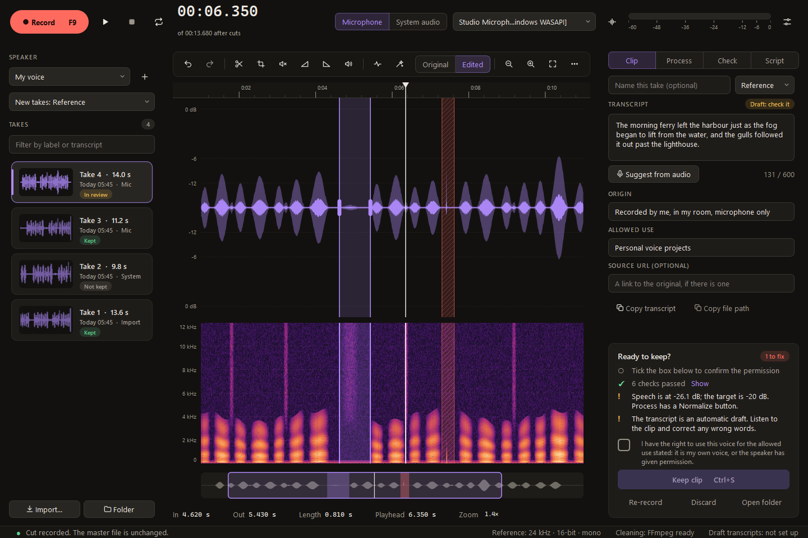

| Area | What it holds |
|---|---|
| **Top bar** | Record (`F9`), Play (`Space`), Stop, Loop (`L`); the clock; the source (Microphone or System audio), the device, and which input of it when it has several; the Arm button; the level meter; and the gear menu with Settings, Import, the speaker's commands, Move take to speaker, Save a copy, Export manifest, Export dataset, Split at pauses, the commands for several takes, Load script, Open output folder and more. |
| **Left** | The speaker, what new takes are for, a box that filters the takes, and that speaker's takes. Each take shows a small waveform, its label (or its number and length, until you name it), when it was made, and a status: *Recording*, *In review* (the take that is open), *Kept*, *Changed* (kept, with changes the kept clip does not have yet), *Not kept*, or *Not saved* (the original could not be written yet). Hover over a take to see its length, when and from where it was made, and the start of its transcript. Right-click a take for its menu. See [Naming and finding takes](#naming-and-finding-takes), [Moving a take](#moving-a-take-to-another-speaker), and [Sharing your clips](#sharing-your-clips) for dragging a kept clip out of the window. |
| **Middle** | The editor: tools, the waveform, a spectrogram, an overview strip, the words of the take when it has a draft transcript, and a line with In, Out, Length, Playhead and Zoom. While recording it shows the live waveform and a take-length guide instead. |
| **Right** | Four tabs, **Clip**, **Process**, **Check** and **Script**, and under them the **Ready to keep?** card with the permission box, Keep, Re-record, Discard and Open folder. |
| **Bottom** | A status line, and the state of the optional extras (FFmpeg and draft transcripts). |

When nothing is open, the middle of the window offers **Record** and **Import a recording**:

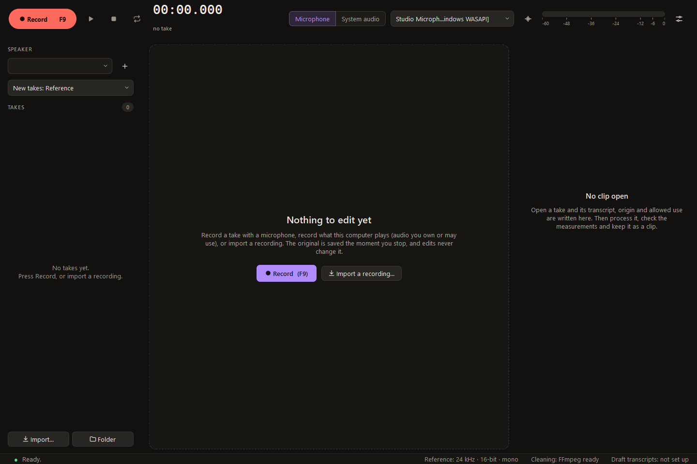

The window can be resized down to 1100 by 600. Buttons that no longer fit collapse into a menu instead of being cut off, and
in a short window the notes in **Ready to keep?** fold into one line, with **Show** to open them.

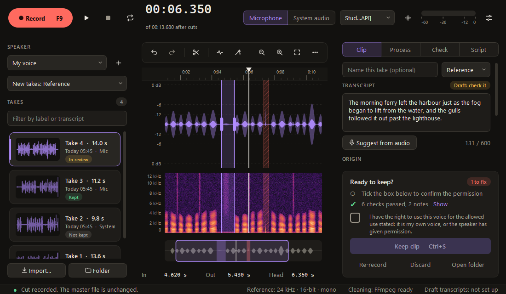

## What a take is for

Under the speaker you choose what new takes are for. Each purpose has its own rules, and the length guide, the checklist, the
Check tab, Auto fix and Keep all follow them.

| Purpose | For | A clip can be | Best | A recording stops at | Kept as |
|---|---|---|---|---|---|
| **Reference** | One good clip of a voice, for a text-to-speech tool | 6 to 40 s | 10 to 25 s | 2 minutes | 24 kHz, 16-bit |
| **Sentence** | One sentence per take, for a dataset or voice banking | 1 to 15 s | 2 to 10 s | 1 minute | 24 kHz, 16-bit |
| **Audition** | A full performance, kept at the best quality | 3 s to 10 minutes | 30 s to 3 minutes | 15 minutes | up to 48 kHz, 24-bit |

A recording can run past what can be kept, so it never stops in the middle of a sentence. The take can then be trimmed, or
[split](#splitting-a-long-take). An audition is never kept above the rate it was recorded at, because that adds no detail: a
44.1 kHz microphone gives a 44.1 kHz clip.

The **Clip** tab changes the purpose of one take, beside its label. Changing it on a kept clip counts as a change, and
**Update kept clip** writes the clip again in the new format.

## Recording

1. Choose a **source** at the top.
   - **Microphone** lists the input devices Windows reports. The same microphone can appear more than once, once for each
     Windows audio interface (WASAPI, MME, DirectSound, WDM-KS); if one entry gives no sound, try another.
   - **System audio** records what the computer is playing through the chosen output (WASAPI loopback). Use it only for
     audio you own or may use; see [Responsible use](responsible-use.md). It records only while something plays.
2. Click **Arm** (`Ctrl+M`) to open the input before you record. The level meter becomes live, and Voice Slate keeps
   the last half second, so when you press Record the beginning of the first word is already included. It stays armed
   after each take until you click **Arm** again, so every take of a session starts the same way. Arming is optional:
   Record opens the input itself if you did not, and lets it go again when the take ends.
3. Press **Record** (`F9`). The clock runs, the waveform draws live, and a bar shows where the take length falls against
   the rules of its [purpose](#what-a-take-is-for). A take that passes the longest clip goes on recording, into the red part of
   the bar, up to the longest recording.
4. Press `F9` (or **Stop**) when you have finished. Recording carries on for a short **stop tail** (half a second by
   default, see [Settings](#settings)) so the end of the last word is not cut off.

If your device has several inputs, a picker appears beside it. **Mix 1+2** mixes the first two, and **Input 1**, **Input 2** and
so on record that input alone, as a mono take. With one microphone on a two-input interface, choose its input: mixed with a
silent one, the voice comes out 6 dB low. The status line tells you if it sees that happening. The device and the input you
choose are remembered.

The record key works while the Voice Slate window is in front. [Settings](#settings) can change it, and can let it work
while another program is in front too, so you can start and stop a take from the page you are reading or the program that is
playing the audio you capture. That is off until you turn it on, because while it is on no other program receives the key, and
a stray press starts the microphone. When it is on, the taskbar button flashes when the key is heard, and while a recording runs
with the window out of sight, a small sign stays on top of everything with the time and the key that stops it; a click on the
sign stops the take. A dialog that is open is never interrupted by a recording starting, though a recording can always be
stopped.

While you record, the take is written to a `.spool` file in the speaker's `masters` folder. If the program or the computer
stops in the middle, the next start makes a take of what was on disk, marks it *interrupted*, and says so in the status
line; a crash costs the last moment, and a power cut at most the last two seconds. If that file cannot be written (a full
disk, say), the status line says so and the recording carries on in memory.

The moment you stop, the original recording is written to the `masters` folder as a 24-bit WAV and the spool file goes.
Nothing you do afterwards can change that file, and closing the program never loses a take. If the device disappears
while recording, what was captured so far is kept and the take is marked *interrupted*. If the device reports that it lost
audio along the way (a busy computer, say), the status line says so, the take is marked *dropouts*, and **Ready to keep?**
reminds you to listen for gaps.

Your work on a take is saved too. A moment after each change, your cuts, the Process settings and the text you typed (the
transcript, label, origin, allowed use and notes) are written to an `.autosave.json` file in the same `masters` folder, so
a crash, a power cut or closing the window does not lose them: when you start the program again the take is there with its
edits and its text, and the status line says so. What does not come back is the undo history, and the permission box,
which is never remembered and is ticked again when you keep the clip. Keep deletes the autosave file, because the sidecar
holds the work from then on. If it cannot be written (a full disk, say), the status line says so, and the window warns you
once when you close it.

The same goes for a clip you have already kept and then change: your changes are saved, and the take shows *Changed*, until
**Update kept clip** writes them. The kept WAV and its sidecar stay as they were until then. To drop the changes instead,
right-click the take and choose **Go back to the kept clip...**. A new label is the exception: it goes straight into the
sidecar.

Use **Re-record** to throw a take away (it goes to the Recycle Bin) and start another straight away.

## Script mode

Script mode shows one prompt per take, which is handy for reading a list of sentences.

1. Write the prompts in a text file, one per line. UTF-8 is best, and Notepad's other choices work too. Empty lines are
   ignored.
2. Choose **Load script** from the gear menu (`Ctrl+Shift+L`).
3. The current line appears above the waveform in large type. Move along the script with `Ctrl+Up` and `Ctrl+Down`, or
   the arrow buttons beside the line.
4. Record the take. The line becomes its transcript, marked in the sidecar as *read from script* (or *edited* if you
   change it). After you **Keep** the take of the line on screen, the script moves to the next line that has no kept clip.
   Updating a kept clip, or keeping an older take of another line, leaves the script where it is.

The **Script** tab lists every line with a mark: ✓ has a kept clip, ● has a take, ○ not yet. It is worked out from the takes of
the speaker in front, so the same script can be read by several people. Click a line to go to it. **Next line to record**
(`Ctrl+Shift+Down`) goes to the next line with no kept clip.

The script and your place in it are remembered, in a small `script.json` beside the settings, so a long list can be read over
several sittings. **Clear script** in the gear menu stops using it.

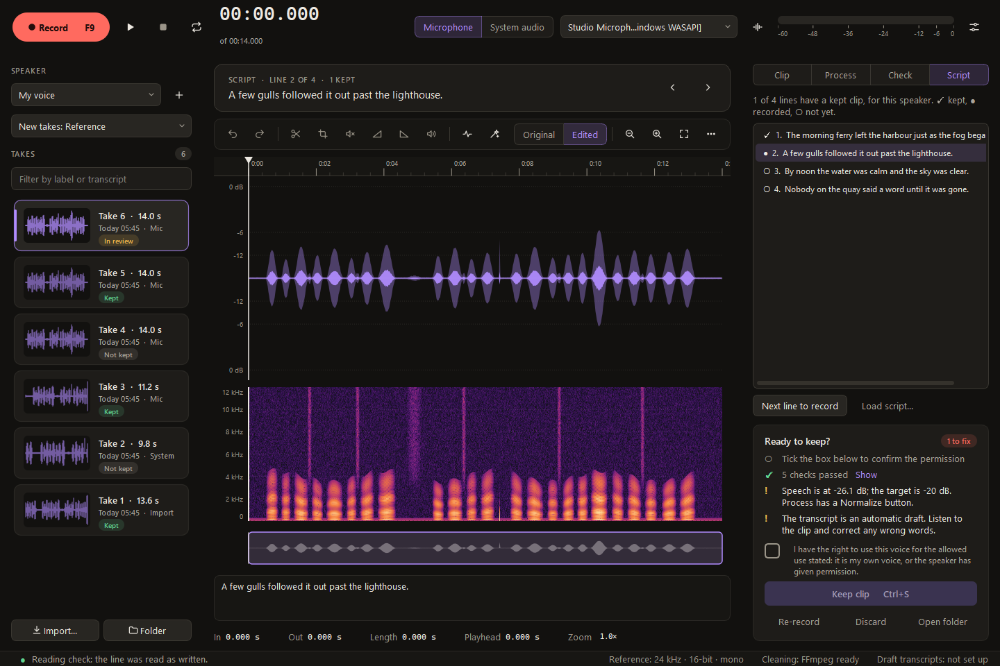

### The reading check

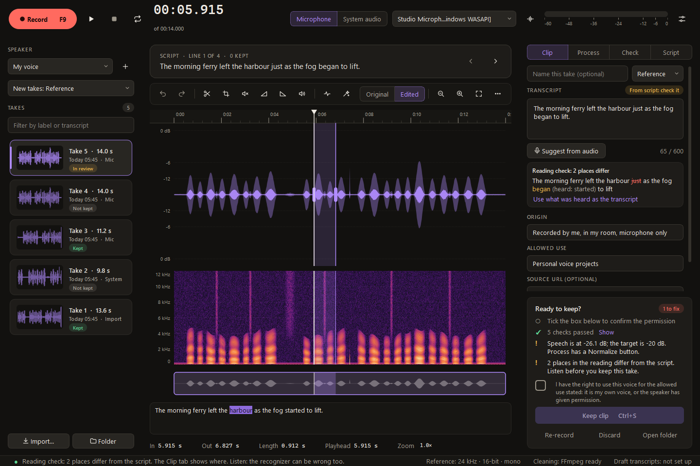

If you set up draft transcripts, each take read from a script is also heard by the speech recognizer, and the Clip tab sets the
two side by side. *Reading check: read as written* means they agree. Otherwise the line is shown with the places that differ: in
amber a word heard as another, in red a word not heard, and in violet a word heard that is not in the script. **Ready to keep?**
mentions it too, and it never stops you keeping the clip: the recognizer gets words wrong as well, so a difference is a place to
listen, not a mistake. If you said something else on purpose, **Use what was heard as the transcript** does what it says.
Capitals and punctuation do not count as differences. After a cut, the check is made again.

## Importing audio

Press `Ctrl+O`, click **Import**, or drag audio files onto the window. A WAV, FLAC, Ogg, MP3 or AIFF file is copied
into the current speaker's `masters` folder as a new take. Your file is not touched, and the take is edited and kept like
a recording. A file with no audio in it, or a damaged one, is refused with a message. Only import audio you have the right
to use.

## Speakers

A speaker is a person whose voice you are recording, and has their own folder. Add one with the **+** next to the
speaker list, or `Ctrl+N`. After the first Keep for a speaker, the origin and allowed-use texts are remembered and
filled in for their next takes. Your confirmation of permission is never remembered: it is asked for every clip.

To change the name a speaker is shown under, choose **Rename speaker...** in the gear menu, or right-click the speaker
list. Only the name changes: the speaker's folder keeps its old name, so no clip moves and nothing already kept is
touched. Two speakers cannot have the same name.

### A speaker's signed release

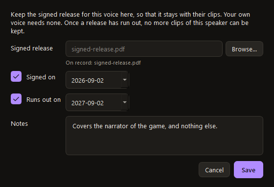

When a voice is not your own, keep the signed release with the clips. **Speaker details...** (the gear menu, or right-click the
speaker list) takes the file, such as a signed PDF, when it was signed, when it runs out, and notes. A copy goes in a `release`
folder in the speaker's folder, so it stays with them, and an earlier file stays there when you add a new one.

Each clip kept after that names the release in its sidecar. A chip under the speaker warns when it runs out within 30 days. Once
it has run out, **no more clips of this speaker can be kept**, and a manifest or dataset leaves their clips out and says why,
until you put a new release on record. This is a record of what you hold: it does not replace the statement you make for each
clip, and the program cannot tell whether the file is what it says it is.

### Deleting a speaker

**Delete speaker...** (the gear menu, or right-click the speaker list) moves the speaker's whole folder to the Recycle Bin: their
kept clips, their original recordings, and their release. It says how much that is first. If the Recycle Bin cannot take it, it
asks before deleting anything for good. You can restore the folder from the Recycle Bin, but the speaker has left the list: put
the folder back and add them again under the same name. Empty the Recycle Bin when someone asks you to delete their voice.

## Moving a take to another speaker

A take that was recorded under the wrong speaker can be filed under the right one. Right-click the take and choose **Move
to speaker**, or open it and choose **Move take to speaker...** in the gear menu, and pick the speaker. It needs a second
speaker to move to, and it is not possible while recording. The take joins the other speaker's list, newest first like
any list. If it was the open take, the next one in the old list opens in its place.

- **A take that is not kept** moves with its original recording, its edits and its text, and you carry on editing it. If
  it still has the origin and allowed use that were remembered for the old speaker, it takes the new speaker's instead;
  texts you wrote yourself stay as they are.
- **A kept clip** asks first, because its permission was about one person's voice. It moves exactly as it was kept: the
  permission, origin and allowed use are not changed, and its sidecar gets a `moves` entry saying which speaker it came
  from and when, so the history stays with the clip. If the other speaker has a clip with the same file name already, a
  number is added to the moved one.

The move is careful. The files are copied to the new speaker's folder and checked against the originals, the new
description is written, and only then are the old files removed. If anything goes wrong on the way, the take stays where
it was and the half-made copies are removed. If an old file cannot be removed afterwards (a locked file, say), the status
line names it so that you can delete it yourself; until you do, it can show up again under the old speaker.

## Naming and finding takes

Takes are numbered *Take 1*, *Take 2* and so on from the oldest. To give one a name you can find it by, type it in the
field at the top of the **Clip** tab, press `F2`, or right-click the take and choose **Rename**. The label (one line, up to
80 characters) replaces the number in the list. It is saved with the take: in its autosave file until the clip is kept,
and then in the sidecar. Changing the label of a kept clip is saved at once, without pressing Keep.

The box above the list filters the current speaker's takes. Type some words, and only the takes whose label, transcript or
notes contain all of them are shown, in any order and whatever the capitals; the counter beside **Takes** says how many of
how many. The numbers do not change while a filter is on. Clear the box to see every take again.

## Several takes at once

Hold `Ctrl` and click takes to select several, hold `Shift` to select a run of them, or press `Ctrl+A` in the list to select them
all. A plain click goes back to one take. The take in front does not change while you do this. Right-click the selection, or use
the gear menu, to:

- **Keep them.** A dialog shows what the takes say about their origin and allowed use, how many say each thing, and a box that
  starts empty. **Keep stays off until you tick it**, every time: this is your statement that you have the right to use this voice
  for each of them, made once, for what is in front of you. Takes that say nothing about their origin or allowed use need words
  typed there, which go on those takes only. Each kept clip records your statement, the time, and how many takes it covered
  (`consent_batch`). A take that cannot be kept (too short, no transcript, a transcript that needs checking after cuts) is left
  out and named, and the statement does not stay on it.
  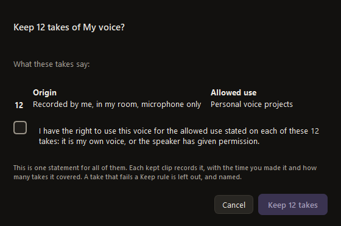

- **Discard them.** They go to the Recycle Bin after one question. If the Recycle Bin cannot take them, the job stops: this never
  deletes anything for good. `Delete` does the same while the list has the focus.
- **Move them** to another speaker. Kept clips ask first, as they do one at a time.

A long job works through the takes a few at a time and the window stays alive. The status line says how far it has got, and
**Stop** beside it stops after the take being worked on. What is done stays done. Anything left out is named at the end.

## Editing

Open a take from the list to edit it. Everything here is a step in a list kept beside the original recording, so
nothing is permanent until you Keep, and even then the original stays.

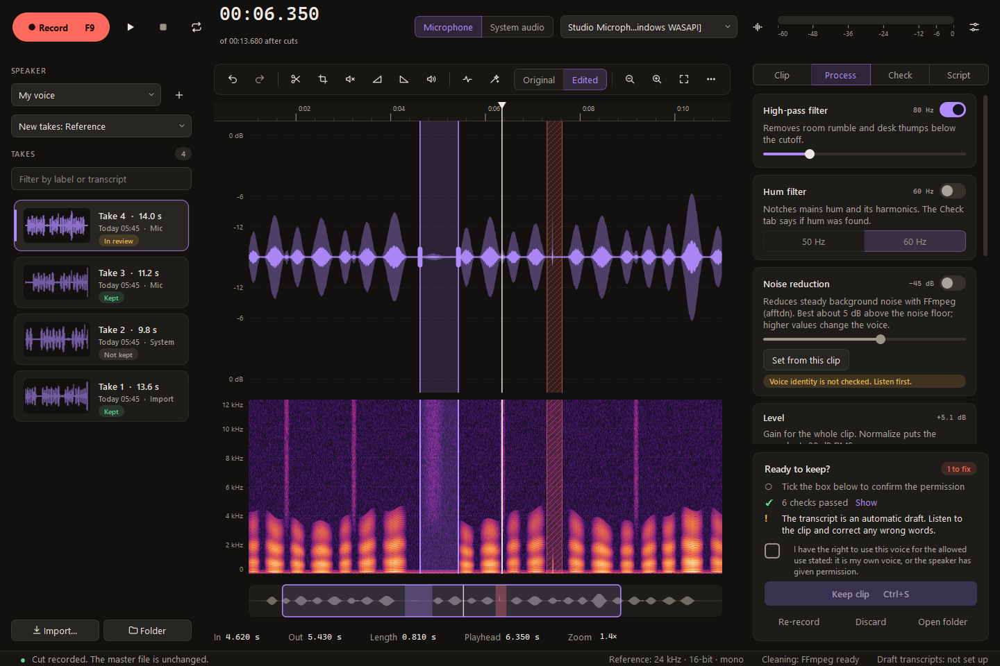

### Selecting and moving around

| To | Do this |
|---|---|
| Select a part | Drag on the waveform. `[` and `]` set the start and end at the playhead. `Ctrl+A` selects everything. |
| Move the playhead | Click, or use `Left`/`Right` (10 ms), `Shift` for 100 ms, `Ctrl` for 1 s, `Home` and `End`. |
| Zoom | Mouse wheel; `+` and `-`; `0` fits the whole clip; `Z` fills the view with the selection. `Shift` and the wheel scroll while zoomed. |
| Listen | `Space` plays or pauses from the playhead; `L` loops the selection (or the whole clip). `Esc` stops, and then clears the selection. |
| Compare | **Original / Edited** (or `A`) switches between the untouched recording and the edited clip, at the same moment. |

### Tools

| Tool | What it does |
|---|---|
| **Cut** (`Delete`) | Removes the selection. The two sides are joined with a short crossfade, and the cut point moves to the nearest zero crossing so it does not click. |
| **Trim to selection** (`Ctrl+T`) | Keeps only the selection. |
| **Silence** (`Ctrl+L`) | Replaces the selection with silence and keeps its length. |
| **Fade in / Fade out** | Fades the selection in from, or out to, silence. |
| **Gain** | Raises or lowers the selection by a number of dB (-60 to +24). |
| **Auto analyze** (`Ctrl+Shift+A`) and **Auto fix** (`Ctrl+Shift+F`) | Say what could be better about the clip, and repair what can be repaired, in one undo step. See [Auto analyze and Auto fix](#auto-analyze-and-auto-fix). |
| **Auto-trim ends** | Cuts the pauses at both ends of the clip down to 0.15 seconds. |
| **Shorten pauses** | Cuts the long pauses inside the clip down to half a second each. |
| **Check joins** | Plays one second either side of every cut, so each join can be judged by ear. |
| **Split at pauses** | Makes a new take of each part of a long take. See [Splitting a long take](#splitting-a-long-take). |

On a narrow window the least-used buttons (Split at pauses, Auto-trim ends, Shorten pauses and Check joins first) move into the
**...** menu at the right of the toolbar; the same commands are in it.

### Editing by the words

When a take has a draft transcript, its words appear under the waveform. Click a word to select it on the waveform, Shift+click
another to select everything up to it, and press `Delete` to cut, as for a selection made by dragging. A word that was cut stands
struck through, and clicking it brings it back. Silence works the same way.

The times come from the speech recognizer, which is good but not exact, more so with the `tiny` model. The selection moves to
the quiet just outside the words, and you can see and adjust it on the waveform before you cut. **Check joins** plays the result.

Right-click the waveform for these and for *Cut from start to here*, *Cut from here to end*, and *Remove* for any edit
under the cursor. `Ctrl+Z` undoes and `Ctrl+Y` redoes; the **History** list on the Process tab lets you click any
earlier step.

If you cut or silence a part that might hold spoken words, the transcript has to be confirmed again before you can keep
the clip: read it against the clip and choose **It matches**. Fades, gain and the Process settings change no words, so they
do not ask, and neither does undoing back to the cuts you confirmed.

## Splitting a long take

**Split at pauses** (the toolbar's **...** menu or the gear menu) makes a new take of each part of a long take, cut in the middle
of its pauses. It says how many takes that will be, and how long, before it does anything. A part runs on to the first pause of at
least a third of a second after it reaches the shortest good length for its purpose (2 seconds for a Sentence), so parts end where
the speaker stopped. A last part too short to keep joins the one before.

The long take stays as it is, so nothing is lost, and each part starts from the original recording, without the long take's
edits. If the long take had a draft transcript, each part gets its share of the words; otherwise each is drafted by itself if you
set that up. Each part is an ordinary take: edit it, keep it or discard it. Its sidecar says which take it came from
(`split_from`). When you have what you want, discard the long take.

## Process the whole take

The **Process** tab holds settings for the whole clip. Each change is one undo step. They run in a fixed order: cuts,
silence and fades, then the filters, then noise reduction, then level, then the limiter, then export. The limiter's ceiling
holds for the 24 kHz file that is saved: resampling cannot push a peak above it.

| Step | What it does |
|---|---|
| **High-pass filter** | Removes rumble and desk thumps below a cutoff (20 to 300 Hz, 80 by default). |
| **Hum filter** | Notches mains hum at 50 or 60 Hz and its harmonics. The Check tab tells you when hum was found. |
| **Noise reduction** | Reduces steady background noise with FFmpeg's `afftdn` filter. It needs [FFmpeg](../README.md#optional-extras). The slider is the noise floor in dB (-80 to -20, -45 by default). It works best about 5 dB above the clip's own noise, and **Set from this clip** measures that and sets it for you: values nearer -20 clean more, and take more of the voice with the noise. The recorder cannot check that the cleaned voice still sounds like the original, so listen to the result, and the sidecar records `identity_checked: false`. |
| **Level** | A gain for the whole clip (-24 to +36 dB). **Normalize** sets the speech to -20 dB RMS, measured on the spoken parts only; unless the limiter is on, it will not let a peak go above -0.45 dBFS. **Reset** goes back to the recorded level. |
| **Peak limiter** | A look-ahead limiter with a ceiling you set (-1 dB by default), so one loud pop does not stop you raising the speech. |
| **Join fade** | The crossfade at every cut, 0 to 50 ms (10 by default). |

Clean first, then normalize: raising the level raises the background noise along with the speech.

## Check

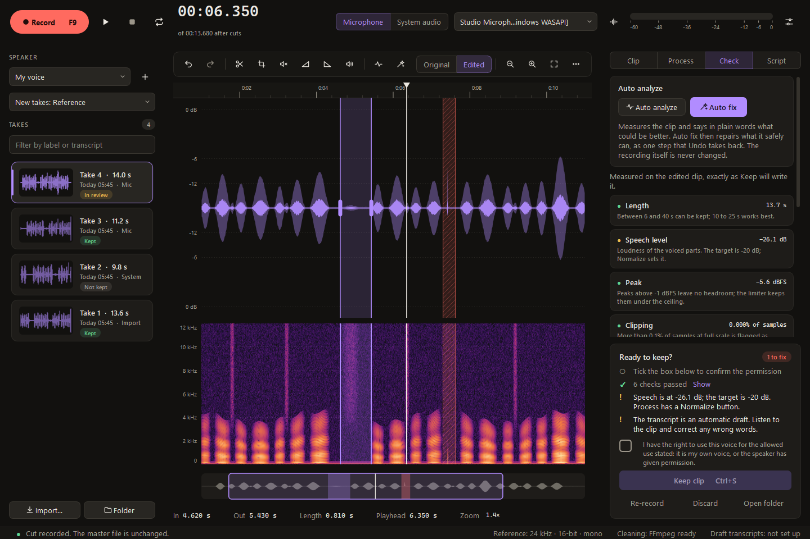

The **Check** tab measures the clip exactly as Keep would write it, and gives each measure a verdict and a plain
explanation: length, speech level, peak, clipping, loudness (LUFS), noise floor, bandwidth, mains hum, silence at the ends,
and how much of the clip is silence. They are advice. Only the length and "not silent" rules in the section after next
stop you keeping a clip.

Clipping is counted on the recording behind the clip as well as on the clip itself. Gain and the limiter can bring clipped
peaks down so that the finished clip measures clean, but the damage is still in it. A part you cut or silenced does not
count, because it is no longer in the clip.

The noise floor is read from the quietest stretch of the clip (the quietest tenth of it, or the quietest fifth of a
second, whichever is lower), so a take needs at least a short pause to be measured. Cutting the pauses short does not
make the clip look noisier.

## Auto analyze and Auto fix

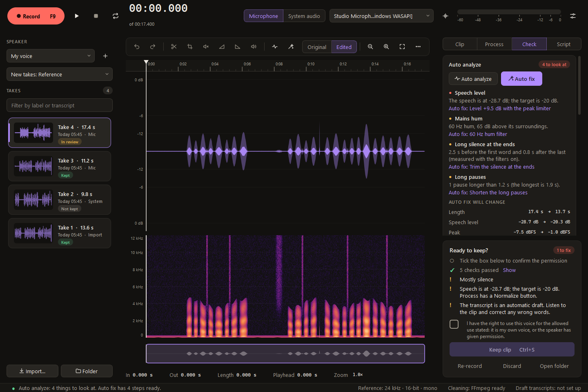

**Auto analyze** (`Ctrl+Shift+A`, the pulse button in the toolbar, or the button on the Check tab) measures the clip and
says in plain words what could be better, worst first. Each finding has a verdict (red: fix it; amber: worth a look) and
says what **Auto fix** would do about it. It looks for:

| Finding | What Auto fix does |
|---|---|
| Long silence at the ends (over 0.8 s) | Cuts it down to 0.15 s, the same as **Auto-trim ends**. |
| Long pauses inside the clip (over 1.2 s) | Shortens each to 0.6 s. |
| Mains hum | Switches on the hum notch at the frequency it found (50 or 60 Hz). |
| Low-frequency rumble | Switches on the high-pass filter at 80 Hz. |
| Speech too quiet or too loud | Sets the gain that puts the speech at -20 dB, with the peak limiter on so one loud pop cannot hold it down. |
| Peaks above -1 dBFS | Switches on the peak limiter. |
| A clearly noisy clip (speech under 25 dB above the noise) | Switches on noise reduction, set about 5 dB above the clip's own noise floor, but only if FFmpeg is installed, and only if trying it on a copy lowers the noise by at least 3 dB without taking more than 4 dB from the voice in any band. |
| Slightly noisy (25 to 35 dB) | Nothing. Noise reduction can change the voice, so the finding tells you to try it yourself on the Process tab. |
| Clipping, a telephone-quality recording, a clip that is too short or too long | Nothing: these cannot be repaired. The finding says what to do instead, and clipping stays on the list after the limiter has brought the peaks down. |

**Auto fix** (`Ctrl+Shift+F`, the wand button) applies the plan. All of it is **one undo step** (`Ctrl+Z` takes it all
back), and the original recording is never touched. Your own settings are respected: a filter you already switched on
stays on (a hum notch is moved only if it is at the wrong frequency), and the gain is replaced by the level Auto fix
works out. Pressing Auto fix before analyzing analyzes first and then fixes. When cuts are made, the transcript has to be
confirmed before Keep, as for any cut.

The card lists, before and after, the measurements that change (length, speech level, peak, hum, the silence at the
ends, and how far the speech is above the noise). Once you have asked, the card follows the clip as you edit it, and
after an Auto fix it lists what was done and what is left. A clip that needs nothing says **Nothing to fix**.

Auto fix is deliberately cautious: it only uses the tools on the Process tab and the cuts of Auto-trim and Shorten
pauses, so you can see, adjust or undo every step. It cannot add speech, remove other voices or repair clipping.

## Keeping a clip

The **Ready to keep?** card lists what is still needed, with a count of the problems. A clip can be kept when:

- its length fits its [purpose](#what-a-take-is-for) (**6 to 40 seconds** for a Reference), and it is **not silent**;
- the **transcript** is 3 to 600 characters. Type it. If you set up draft transcripts, a draft appears by itself when a
  take is added and its transcript is empty (the Clip tab says *Drafting...* while it is made), and **Suggest from
  audio** asks again from the edited clip. While the text is still exactly the recognizer's own, it follows your cuts:
  a moment after you stop cutting, a new draft of the edited clip replaces it. Text you typed or corrected is never
  replaced that way. A draft is a guess: listen and correct it;
- the **origin** (where the recording came from) is entered;
- the **allowed use** (what the voice may be used for) is entered;
- you ticked **the permission box**, right above the Keep button: you have the right to use this voice for the allowed use
  stated, because it is your own voice or the speaker has given permission. The tick is a statement about what is written
  there, so changing the origin or the allowed use clears it, on a kept clip as well, and it has to be given again;
- the transcript still matches the words after any cuts;
- if the speaker has a [signed release](#a-speakers-signed-release) on record, it has not run out.

Press **Keep clip** (`Ctrl+S`). If something is missing, a message lists it and nothing is written. Otherwise Voice
Slate writes the mono WAV, in the format of the take's [purpose](#what-a-take-is-for), and the sidecar JSON next to the
original, deletes the take's autosave file, and the take shows *Kept*. Keeping a kept clip again rewrites only that clip's own two files. If the files cannot be written (a full
disk, a file open in another program), a message says why, the take stays as it was, and you can press Keep again once the
problem is fixed.

The sidecar also records how the transcript came about (typed, read from a script, a draft from the recognizer, or
edited), when you ticked the permission box, the label if the take has one, and every edit and setting used. See
[Clip format](clip-format.md).

**Discard** moves the take's files (the original, the export and the sidecar, and the autosave file if there is one) to
the Recycle Bin, after asking, so you can restore them from there. If the Recycle Bin cannot take them (a network folder,
say), the program says so and offers to delete them permanently instead; it never does that without asking.

## Sharing your clips

A kept clip is an ordinary file in the speaker's folder. Voice Slate gives you four ways to hand clips on without
searching through the folders. They only write files on your own computer, and none of them changes a kept clip.

### Drag a clip into another program

Pull a kept take's card out of the list and drop it on a folder in Windows Explorer, in a chat window, in an audio
program, or on anything else that accepts a file. The clip's WAV file is **copied** there: the original stays in the
library, and a drag cannot move it out. A small movement is still a click that opens the take, and nothing is dragged for
a take that is not kept, or while recording.

Only the audio goes. The permission and origin are in the clip's sidecar, the `.json` file with the same name next to
it, so send that along too when the voice is not your own (see [Responsible use](responsible-use.md)).

### Save a copy

For a place that wants another format or sample rate, choose **Save a copy...** in the gear menu (`Ctrl+Shift+S`), or
right-click a kept take. Choose the format and the sample rate, then the file name:

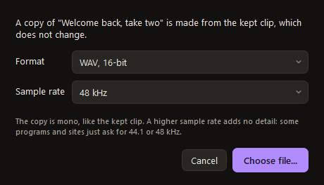

| Format | |
|---|---|
| **WAV, 16-bit** | Uncompressed. |
| **FLAC** | The same audio, lossless, in a smaller file. |
| **MP3, 128 kbit/s** | Small, and lossy. |
| **Ogg Vorbis** | Small, and lossy. |

The sample rate can be 16, 22.05, 24, 44.1 or 48 kHz. The copy is made from the kept clip, so a rate above the clip's own adds
no detail; it is there for programs and sites that ask for 44.1 or 48 kHz. For that detail, use a
[dataset](#export-a-dataset) made from the originals. The copy is a plain
audio file: it has no sidecar, Voice Slate does not list it, and the permission records stay with the kept clip. It cannot
be saved inside the output folder, so that it is not taken for a kept clip. FFmpeg is not needed. The file dialog asks
before it replaces a file.

### Export a manifest

A manifest is one file that lists the kept clips with their transcripts, so that a program that trains or tests on speech
can read the whole set instead of walking the folders. Choose **Export manifest...** in the gear menu, say whether it
should list the open speaker's clips or everyone's, and choose **JSON Lines** (`.jsonl`, one JSON object per line) or
**CSV** (`.csv`, for spreadsheets and data tools), then the file name.

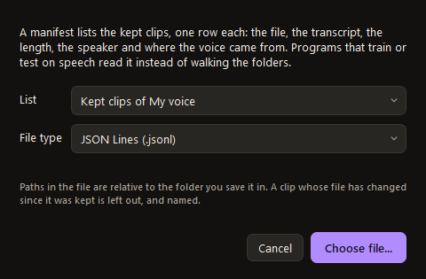

Each kept clip is one row, with `audio_filepath`, `text` and `duration`, which are the names that speech toolkits such as
NeMo read, followed by `speaker`, `speaker_id`, `label`, `sample_rate`, `source`, `created`, `id`, `origin`,
`allowed_use`, `transcript_status` and `sha256`. The audio paths are written relative to the folder the manifest is saved
in (with forward slashes), so a manifest saved in the output folder keeps working when the folder is copied; on another
drive, where there is no relative path, the full path is written. Rows are in the order of the speakers' names, then of
when the clips were made. [Clip format](clip-format.md) describes each column.

A clip is **left out, and named in a message**, when it cannot be vouched for: its sidecar cannot be read or does not
record the permission, its WAV is missing, or its WAV has changed since it was kept (the program checks the SHA-256 of
every WAV). A take that is not kept is never listed. A spreadsheet can run a cell that starts with `=`, `+`, `-` or `@` as a
formula, so in the CSV such a text gets a `'` in front of it; the JSON Lines file holds every text exactly as it is. The CSV
is UTF-8 without a byte-order mark, which is what data tools expect; if Excel shows accented letters wrongly when you
double-click it, open it with *Data > From Text/CSV* and choose UTF-8.

A manifest holds transcripts and notes about where each voice came from. Treat it like the recordings themselves.

### Export a dataset

A dataset is the kept clips gathered in one new folder, for a tool that trains or tests on speech. Choose **Export dataset...** in
the gear menu, say whose clips, the layout, the sample rate and what to make the audio from, then choose an empty folder outside
the output folder.

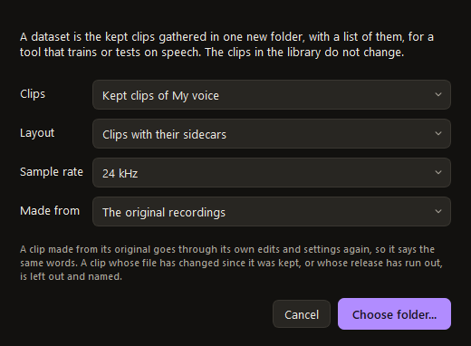

| Layout | What it holds |
|---|---|
| **Clips with their sidecars** | A folder for each speaker, with each clip's WAV and its sidecar beside it, so the permission travels with the audio. |
| **LJSpeech** | A `wavs` folder and a `metadata.csv` of `name\|text\|text` lines, the layout many text-to-speech tools read. It starts at 22.05 kHz, 16-bit, which is what the LJSpeech set itself is. |

Both also get a `manifest.jsonl` with the origin and allowed use of every clip.

**Made from** decides what the audio is. *The original recordings* goes through each clip's own edits and settings again at the
rate you chose, which keeps detail a 24 kHz clip no longer has; a clip with noise reduction on needs FFmpeg for this. *The kept
clips* resamples what was kept, which is quicker. The clips that go in are the ones a manifest would list, so one that has changed
since it was kept, or whose release has run out, is left out and named. The job runs a few clips at a time, and **Stop** in the
status bar stops it, keeping what is done.

## Settings

Open them with the gear at the top right, or `Ctrl+,`.

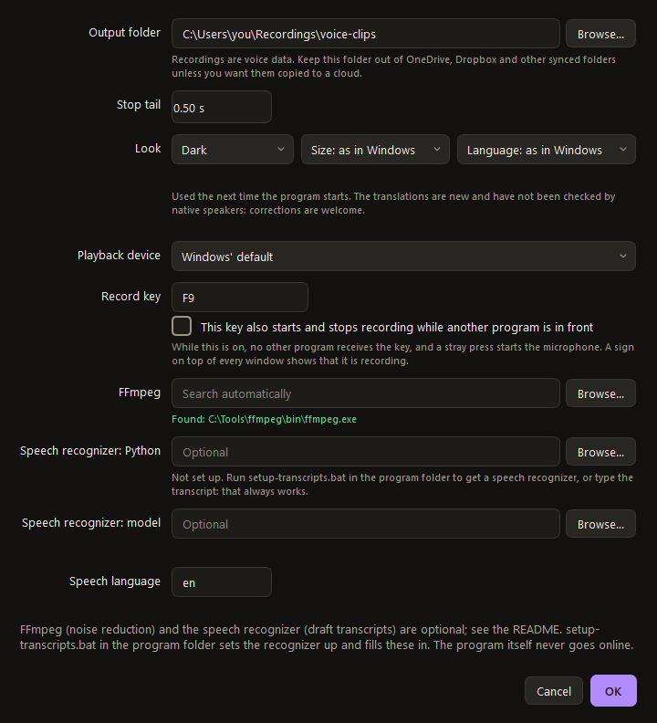

| Setting | Meaning |
|---|---|
| **Output folder** | Where speakers, originals and kept clips are stored. By default `C:\Users\<you>\Recordings\voice-clips`. A copy from before 0.5 goes on using the `voice-clips` folder in its program folder if it has recordings in it. Choose another folder and, if the old one has recordings and the new one is empty, it offers to move them: each file is copied and checked, and the old ones go only when all of them have arrived. Keep it out of synced folders unless you want a cloud copy of the recordings. |
| **Stop tail** | How long recording carries on after you press Stop, 0 to 1 second. |
| **Look** | The theme (dark, light, high contrast, or as in Windows), the size of the whole window from 100% to 200%, and the language. They are used the next time the program starts. Without a size chosen it follows Windows' own *Text size* setting, and without a language it follows Windows, if there is a translation. |
| **Playback device** | Where takes are played. Windows' default, unless you choose one. A device that is not connected stays in the list, and playback goes to the default until it is back. |
| **Record key** | The key that starts and stops recording: a function key, or a letter or number held with Ctrl or Alt, so that it cannot be typed by accident. The box below it lets it work while another program is in front, which is off until you turn it on. Windows tells Voice Slate when that one key is pressed; it is not a keyboard hook, and no other key is seen. While it is on, other programs do not receive the key. If another program already holds it, the status line says so at start-up and it works only in this window. |
| **FFmpeg** | Path of `ffmpeg.exe`. Leave it empty to search `PATH` and the WinGet folders. |
| **Speech recognizer: Python** and **model** | The optional draft-transcript setup: a `python.exe` that has [faster-whisper](https://github.com/SYSTRAN/faster-whisper) installed, and a faster-whisper model folder. Both are needed. `setup-transcripts.bat` installs both and fills these in for you (see the README); you only type them here to use a recognizer you already have. |
| **Speech language** | A language code such as `en` or `de`. It makes drafts faster and steadier; leave it empty to have the language found for each clip, which is less reliable on short clips. |

Settings are saved in a small `settings.json`. The recorder looks for it in this order: the file named by the
`VOICE_SLATE_SETTINGS` environment variable; a `settings.json` next to the program (handy for a portable copy);
`%APPDATA%\Fels Voice Slate\settings.json`. It also remembers the window size and position there. A settings file that
cannot be read is moved aside, never overwritten. The first line of `voice-slate.log` names the file in use, and so does
the tooltip of *Draft transcripts* at the bottom of the window.

**About** in the gear menu shows the version, the licence, and the libraries the program is built with.

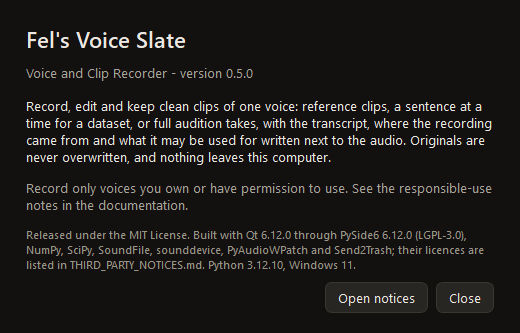

## Using it without a mouse, and with a screen reader

Everything can be reached with `Tab`. In the list of takes, `Up` and `Down` open a take, `Shift` with them selects several, and the
key for a context menu (or `Shift+F10`) opens the menu of the row. On the waveform, `Left` and `Right` move the playhead, `[` and `]`
set the start and end of a selection, and `Delete` cuts it. `Alt+Down` and `Alt+Up` walk the takes from anywhere. The words under
the waveform are links: `Tab` moves between them, and `Enter` selects one.

Every control has a name a screen reader can read, the rows of the list say what each take is, and what the status line says
is read out as it changes: *Recording*, *Take saved*, *Kept*. The marks in the checklist and the script are read as words,
such as *Still to do*. This was checked against what Windows itself tells a screen reader, **not yet with a real screen
reader**: if something reads badly, please
[say so](../CONTRIBUTING.md#reporting-a-problem).

For larger text, use the size in [Settings](#settings), or Windows' own *Text size* setting, which the program follows. The whole
window scales, so a large size needs a large screen: the window needs at least 1100 by 600 at its own scale. All three themes meet
the WCAG AA contrast of 4.5 to 1 for text, and the high-contrast theme goes well past it.

## Keyboard shortcuts

Press `F1` for this list at any time.

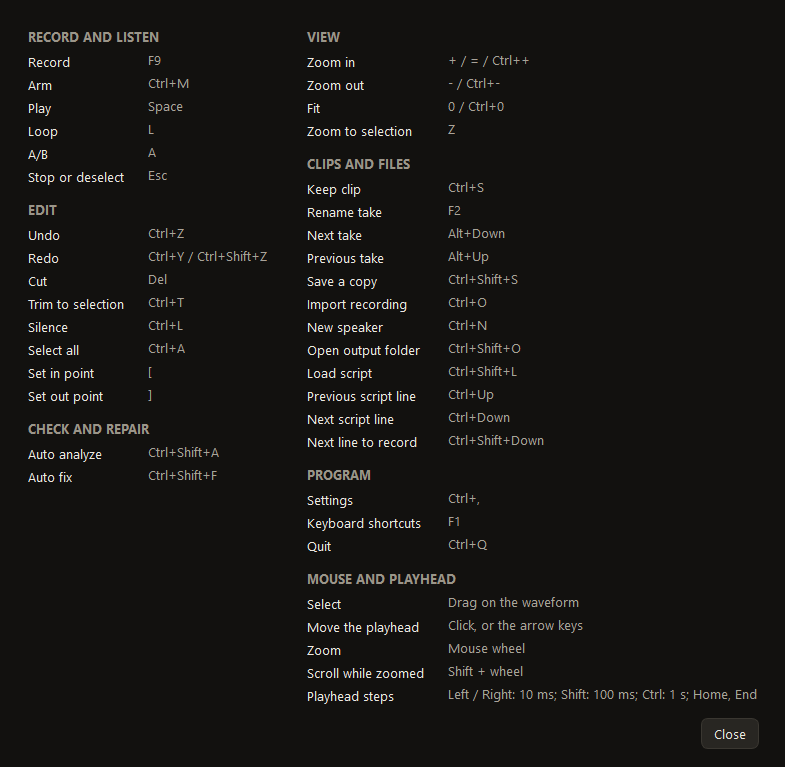

## Troubleshooting

**I double-click the icon and nothing appears.** The program starts with no console window, so a failure is silent
unless it can show a message. Wait a few seconds (it takes one to three to open), then look at the log file,
`voice-slate.log` in the same folder as the settings file (`%APPDATA%\Fels Voice Slate`, or the program folder in a
portable copy). It records every start and any error with its details. `voice-slate-crash.log` beside it is only
written if a native library crashes. Run `run.bat` to see the error in a console, and `python -m recorder --check` to
see whether everything the program needs is installed.

**It says Voice Slate is already running.** Only one copy runs at a time. Look for its window on the taskbar. If it
is not there, it may have stopped without closing: end the `pythonw.exe` process in Task Manager and start again.

**Nothing happens when I start it, or it says PySide6 is missing.** Run `setup.bat` again, or in a terminal
`.venv\Scripts\python -m pip install -r requirements.txt`. If you used the installer, run it again.

**Windows says it protected my PC when I run the installer.** The installer has no paid signature, so SmartScreen does not know
it yet. Choose **More info**, then **Run anyway**. If you would rather not, a copy of the source does the same job.

**The status line says "Could not list devices: cannot load library ... error 0xce".** The program's folder is too deep.
Windows limits a file's full path to 260 characters, and the audio library sits about 80 characters inside the folder.
Move the whole folder somewhere short, such as `C:\VoiceSlate`, delete its `.venv` folder, and run `setup.bat` again.

**My microphone is not listed, or the meter does not move.** In Windows, open *Settings > Privacy & security >
Microphone* and make sure access is on, including *Let desktop apps access your microphone*. Then choose **Refresh
devices** in the gear menu. If the device is listed under several names, try the others.

**System audio says "Nothing captured", or lists no device.** Something has to be playing on the chosen output while you
record. Some setups, such as a remote desktop session, may not offer a loopback device at all.

**The Noise reduction switch is greyed out.** FFmpeg was not found. Install it (`winget install Gyan.FFmpeg`) and
restart, or set its path in Settings.

**Suggest from audio says draft transcripts are not set up.** A new copy of the program has no speech recognizer: it
ships none and downloads none by itself. Double-click `setup-transcripts.bat` in the program folder (or press **Suggest
from audio** and choose *Open the setup*). It asks which model you want, says what it will download, and sets
everything up and checks it. Then start Voice Slate again; the bottom of the window says "Draft transcripts: ready".
If you set your own recognizer in Settings instead, the dialog tells you which of the Python and the model folder is
missing. If you did set them and it still says so, the program is reading a different settings file from the one you
edited: hover over *Draft transcripts* at the bottom of the window to see which one it is. A `settings.json` next to
the program wins over the one in `%APPDATA%`.

**The transcript setup stops with an error.** It changes nothing in your settings when a step fails, so you can run
`setup-transcripts.bat` again. Check the internet connection first (it needs PyPI and Hugging Face), and that the drive
has room: about 450 MB for the recognizer and the base model, 800 MB with `small`. If the message talks about a path
that is too long, the program folder is nested too deeply: move the whole folder somewhere short, such as
`C:\VoiceSlate`, delete its `.venv-asr` folder, and run the setup again. To start over, delete the `.venv-asr` and
`models` folders.

**The transcript setup says it needs Python 3.12 to 3.14** (or an older copy of the program stopped with *No matching
distribution found for ctranslate2*). The speech recognizer is not built for newer Pythons yet. Voice Slate can stay on the
Python it has: install Python 3.14 beside it, by typing `py install 3.14` in a terminal or from
[python.org](https://www.python.org/downloads/), and run `setup-transcripts.bat` again. It finds that Python by itself
and uses it for the recognizer alone.

**The transcript setup says Microsoft's Visual C++ runtime is missing.** The recognizer needs it, and the rest of the
program brings its own copy, which is why everything else works. Install the X64 *Visual C++ Redistributable* from
[Microsoft](https://learn.microsoft.com/cpp/windows/latest-supported-vc-redist) and run `setup-transcripts.bat` again.

**The record key does nothing while another program is in front.** That is off until you turn it on in **Settings**, under
**Record key**. If you did, and the status line said "F9 only works while this window is in front" when the program started,
another program already holds the key (a screen recorder, a game overlay, a macro tool). Choose another key in Settings.

**The voice is very quiet, or only one side of a stereo interface works.** If the device has several inputs, choose the one the
microphone is on in the picker beside the device. Mixing it with a silent input lowers the voice by 6 dB.

**It says the release for this voice ran out.** The date under **Speaker details...** has passed, so no more clips of this speaker
can be kept, and manifests and datasets leave their clips out. Get a new release, put it on record there, and it works again. If
the date is wrong, correct it there.

**The window does not fit the screen.** The size in **Settings** may be too large for this screen, or Windows' own *Text size* may
be set high. The window needs at least 1100 by 600 at its own scale. Choose a smaller size and start the program again.

**My recordings seem to have gone after an update.** Since 0.5 a new copy looks in `C:\Users\<you>\Recordings\voice-clips`. If your
recordings are in a `voice-clips` folder in the old program folder, choose it as the **Output folder** in Settings, or move it.

**A saved clip is missing from the list.** The program lists a message in the status line when a sidecar cannot be used,
and does not change the files. Common reasons are a moved or deleted original, or a sidecar edited by hand. The other clips
load as usual, and the files stay where they are.

**It says "Could not write the files" when I press Keep.** The take is not kept, and nothing was changed: the message gives
the reason, usually a full disk or a clip open in another program. Your work on the take goes on being saved. Fix the
problem and press Keep again.

**It says "Could not play".** The sound could not reach an output device. Check that one is connected and chosen as the
default in Windows' sound settings.

**A message says "Something went wrong".** The program ran into something it did not expect. It says what, and the details
are in `voice-slate.log`. Your recordings are not affected, but the last thing you did may not have finished, so check it.
If it happens again, please [report it](../CONTRIBUTING.md#reporting-a-problem).

**A take I never finished has appeared, marked interrupted.** The program stopped while that take was being recorded, and
the next start made a take of what had reached the disk. Keep it or discard it like any other.

**Dragging a clip out does nothing.** Only the card of a kept take can be dragged, and not while recording. The place you
drop it on must accept files: some web pages take a file only on their own drop area, and Windows does not let a program
drop files onto a program that runs as administrator. **Copy file path** in the take's menu gives the clip's path, and
**Open folder** shows it in Explorer.

**Save a copy asks for a place outside the output folder.** A copy saved among the kept clips could be taken for one.
Save it somewhere else, such as the desktop or a project folder.

**The manifest says some clips were left out.** The message names each one and the reason. A clip whose WAV has changed
since it was kept (its SHA-256 no longer matches the sidecar) is left out on purpose, because its row would describe a
different file; the clip itself is not touched. If you changed it yourself, keep it again from the original, or move the
file back.

**It says the old files of a moved take could not be removed.** The move itself worked: the take is under the new
speaker. The files named are copies left in the old speaker's folder (a locked file, or a folder that does not let the
program delete). Delete them yourself, or they can show up again under the old speaker.

**It says a take is "Not saved".** The original could not be written (a full disk, or a locked folder). The take is held
in memory; fix the problem and press Keep, or close the window and read the message, which tells you if anything is
still unwritten. The window refuses to close while audio exists only in memory.

**The status line says it could not use the saved changes of a take.** The take's autosave file (`.autosave.json`, in
`masters`) is damaged, or belongs to a different recording. The take shows as it was recorded, and the file is left where
it is; the next change you make to the take writes a new one. To get rid of it, delete the file.

**It says it could not save your changes to a take.** The autosave file could not be written (a full disk, or a locked
folder). Your changes are still in the window, and are tried again every few seconds. Fix the problem; if you close the
window first, it warns you once.

If it is something else, please [open an issue](../CONTRIBUTING.md#reporting-a-problem) with the steps to reproduce it.
Do not attach recordings of other people.
